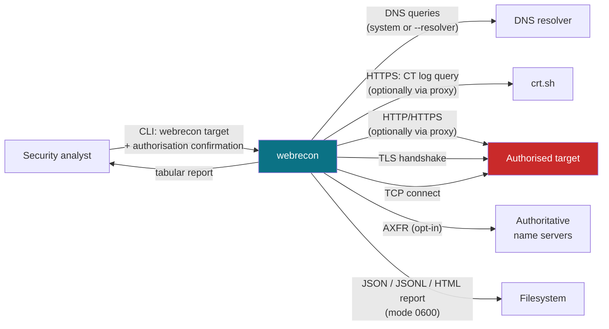
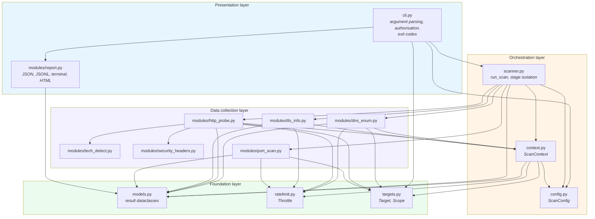
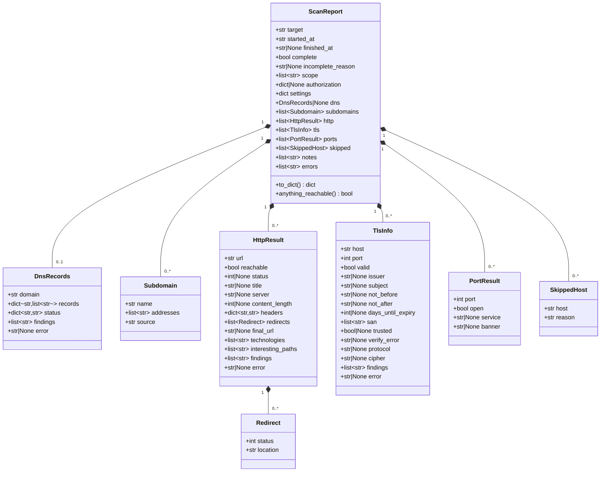
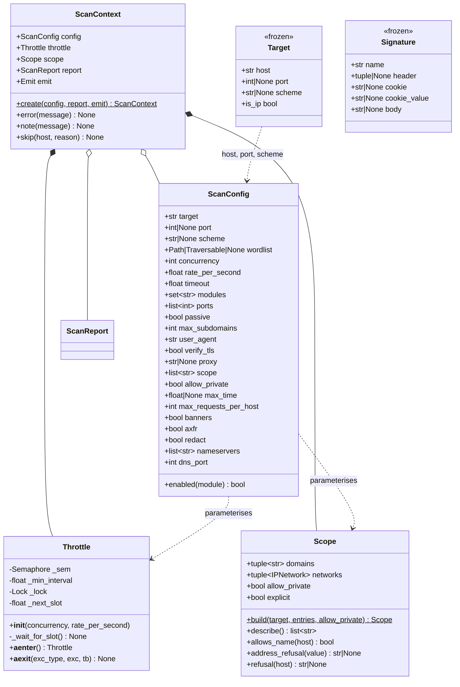
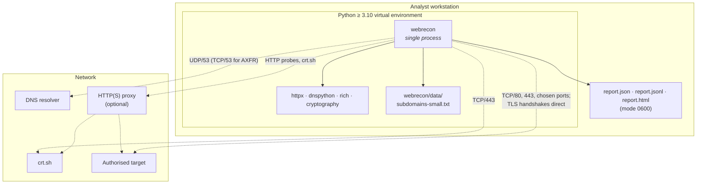

# 1. System architecture

| | |
| --- | --- |
| Document | SDD-01 — Architectural view |
| System | webrecon 0.2.0 |
| Status | Approved |
| Last revised | 2026-11-16 |

## 1.1 Purpose

This document describes the static structure of webrecon: the division into
packages, the dependencies between components, the data model, and the
architectural decisions that constrain the implementation. Runtime behaviour is
covered in [04-runtime-behaviour.md](04-runtime-behaviour.md); the
function-by-function detail in
[03-function-reference.md](03-function-reference.md).

## 1.2 Context view

webrecon is a single-process command line application. It exposes no services,
persists no state between runs, and requires no root privileges.

The target is the only third-party system contacted actively, which is why it
is highlighted: every interaction with it requires prior written authorisation
(see [02-use-cases.md §2.6](02-use-cases.md#26-legitimacy-constraints)). Since
0.2.0 that authorisation is confirmed explicitly before any active module runs
(`--i-have-authorization` or an interactive prompt), and every host the tool
contacts is checked against an explicit scope (ADR-06).

The `--proxy` option applies to the HTTP probes and to crt.sh only; DNS, TLS and
the port scan always connect directly. Proxy environment variables
(`HTTP_PROXY`, `HTTPS_PROXY`) are ignored (`trust_env=False`), so traffic never
takes a route the analyst did not choose on the command line.

## 1.3 Package view

**Dependency rule.** Arrows point downwards, with one deliberate exception: the
collection modules that need the shared scan state (`dns_enum`, `http_probe`,
`tls_info`) receive a `ScanContext` from the orchestration layer. `context.py`
is a passive data holder — it imports only `config` and the foundation layer and
never calls a collection module — so no import cycle arises. No collection
module knows about `report.py` or `cli.py`, which keeps every module usable as a
library independently of the CLI; `port_scan` takes plain arguments and does not
depend on the context at all.

### 1.3.1 Responsibilities per file

| File | Responsibility | Depends on |
| --- | --- | --- |
| [`webrecon/__init__.py`](../webrecon/__init__.py) | Exposes `__version__`, the single source of truth for the version | — |
| [`webrecon/__main__.py`](../webrecon/__main__.py) | Entry point for `python -m webrecon` | `cli` |
| [`webrecon/cli.py`](../webrecon/cli.py) | Argument parsing and validation, target and scope parsing, authorisation gate, `ScanConfig` construction per target, output selection, partial reports on interruption, exit codes | `config`, `scanner`, `targets`, `models`, `modules.report` |
| [`webrecon/config.py`](../webrecon/config.py) | Execution parameters, immutable for the duration of a scan; default ports, web ports, User-Agent, bundled wordlist | `__init__` |
| [`webrecon/context.py`](../webrecon/context.py) | `ScanContext`: the one throttle, scope and report shared by every stage, plus the `emit` callback for incremental output | `config`, `models`, `ratelimit`, `targets` |
| [`webrecon/models.py`](../webrecon/models.py) | Shared result types and serialisation | — |
| [`webrecon/ratelimit.py`](../webrecon/ratelimit.py) | Concurrency and request pacing control | — |
| [`webrecon/targets.py`](../webrecon/targets.py) | Target parsing (domain, IP, `host:port`, URL, IDN), hostname validation, scope and non-public address policy | — |
| [`webrecon/scanner.py`](../webrecon/scanner.py) | Stage sequencing and isolation, target gate, host and port propagation between modules, scan time limit, report metadata | all modules, `config`, `context`, `models`, `targets` |
| [`webrecon/modules/dns_enum.py`](../webrecon/modules/dns_enum.py) | DNS records with per-query status, mail hints, AXFR, passive and active subdomain discovery, wildcard detection | `context`, `ratelimit`, `models`, `config`, `targets` |
| [`webrecon/modules/http_probe.py`](../webrecon/modules/http_probe.py) | HTTP probing, redirect chain with scope and loop checks, header collection and redaction, content discovery, request budget | `context`, `ratelimit`, `models`, `targets`, `tech_detect`, `security_headers` |
| [`webrecon/modules/tech_detect.py`](../webrecon/modules/tech_detect.py) | Signature-based technology fingerprinting | — |
| [`webrecon/modules/security_headers.py`](../webrecon/modules/security_headers.py) | Missing or weak security headers and cookie flags | — |
| [`webrecon/modules/tls_info.py`](../webrecon/modules/tls_info.py) | Asynchronous TLS handshakes, verification status, X.509 decoding | `context`, `ratelimit`, `models`, `cryptography` |
| [`webrecon/modules/port_scan.py`](../webrecon/modules/port_scan.py) | TCP connect scanning, optional sanitised banners | `ratelimit`, `models`, `targets` |
| [`webrecon/modules/report.py`](../webrecon/modules/report.py) | JSON, JSONL, terminal and HTML rendering; private, non-overwriting files | `models` |
| [`webrecon/data/subdomains-small.txt`](../webrecon/data/subdomains-small.txt) | Bundled 138-entry wordlist, shipped as package data | — |

## 1.4 Data model

Every module returns the dataclasses defined in `models.py`. No module returns
raw dictionaries: the conversion to dictionaries happens exactly once, in
`ScanReport.to_dict()` (or in `JsonlWriter.write` for a single incremental
result), immediately before serialisation.

The filled diamond denotes composition: each result lives exactly as long as
the `ScanReport` that contains it, and recursive serialisation through
`dataclasses.asdict` depends on that.

The report carries its own provenance: `scope` (the perimeter as enforced),
`authorization` (operator, instant and method of the confirmation), `settings`
(the effective options, with proxy credentials redacted) and `complete` /
`incomplete_reason`, which tell a consumer whether the scan ran to the end. A
report is created `complete=False` and only flipped to `True` when every stage
has returned.

### 1.4.1 Configuration and infrastructure

`ScanContext.create` builds exactly one `Throttle` and one `Scope` per target
scan; every stage receives the same instance (ADR-01). `Throttle` implements the
async context manager protocol; `Target` and `Signature` are frozen because they
are values shared across all concurrent calls.

## 1.5 Architectural decisions

### ADR-01 — Asynchronous concurrency with one mandatory, shared throttle

**Context.** Scanning is dominated by network latency: hundreds of independent
requests, each idle for most of its lifetime. In 0.1.0 each module built its own
throttle, so `--rate` and `--concurrency` were per module rather than per scan,
and some calls (crt.sh, the target's TLS handshake) bypassed pacing entirely.

**Decision.** All I/O code is `asyncio`. `run_scan` builds one `ScanContext`
holding **one** `Throttle`, which combines a semaphore (how many requests in
flight) with a token bucket (how many requests per second). Every outbound call
in every stage acquires a slot from it: each DNS query (one slot per query, so a
host's A and AAAA lookups take two), the crt.sh request, each HTTP request
including redirects and content discovery, each TLS handshake (one slot per
handshake, so a verified attempt followed by an unverified retry takes two), the
target's address lookup, and each port connection.

**Consequences.** `--rate` and `--concurrency` are genuine ceilings for the
whole scan, verifiable against the loopback test servers. Throughput stays high
without the tool being able to degrade into a denial of service. Modules cannot
use blocking synchronous libraries: the TLS handshake now runs on the event loop
through `asyncio.open_connection` (cancellable, no threads). The only remaining
thread is the optional AXFR transfer, which `dnspython` exposes synchronously;
it is wrapped in `asyncio.to_thread` under a throttle slot and an outer
timeout.

### ADR-02 — Typed contract between modules and presentation

**Context.** With modules returning free-form dictionaries, the report layer has
to guess at the schema and the JSON output becomes unstable.

**Decision.** Every module returns dataclasses from `models.py`.

**Consequences.** The JSON schema is determined by the dataclass definitions, so
it is versionable and verifiable by tests. Adding a field requires touching
`models.py`, which makes the change explicit at review time. The 0.2.0 fields
are all additive with defaults, so a 0.1.0 consumer reading a 0.2.0 report
finds every key it expects.

### ADR-03 — Partial failure rather than total failure

**Context.** In a real scan some portion of the targets is always unreachable,
slow, or misconfigured, and a bug in one stage must not discard what the others
gathered.

**Decision.** Every module catches the expected exceptions and records them in
the `error` field of its own result, or in `ScanReport.errors`. In addition, each
stage runs through `scanner._guarded`, which turns any unexpected `Exception`
into an `errors` entry, and per-host work inside `probe_hosts`,
`inspect_hosts` and `enumerate_subdomains` is isolated in the same way. The
report is filled in place, so the CLI can still write it after a timeout, a
Ctrl-C or a crash.

**Consequences.** The user always gets a report, possibly partial, and a partial
report says so (`complete=False`, `incomplete_reason`). A systematic failure no
longer surfaces as a silent empty result: `fetch_records` names the cause
(NXDOMAIN, timeout, SERVFAIL), a failed crt.sh lookup and an unresolvable port
scan target are recorded as errors, and the terminal and HTML reports list
errors, unreachable hosts and skipped hosts explicitly.

### ADR-04 — TLS verification off for HTTP probes, always reported by the TLS module

**Context.** An expired certificate, or one with the wrong hostname, is exactly
the kind of finding the scan is meant to produce; a probe that refuses such a
host hides it. At the same time a report must not suggest that a certificate is
fine merely because the tool did not check it.

**Decision.** `ScanConfig.verify_tls` is `False` by default for HTTP probes, and
can be turned on with `--verify-tls`. Independently of that option, the TLS
module always attempts a verified handshake first; if it fails with
`ssl.SSLCertVerificationError` it records the reason in
`TlsInfo.verify_error`, sets `trusted=False`, and performs a second, unverified
handshake to read the certificate in DER form.

**Consequences.** The tool observes and reports hosts a normal client would
refuse, and every TLS result states whether the certificate is trusted and why
not. The HTML report states whether verification was on for HTTP probes. Since
webrecon transmits neither credentials nor sensitive data to the target, the
interception risk of unverified HTTP probes is acceptable for this use case.

### ADR-05 — Candidate truncation by confidence

**Context.** `--max-subdomains` caps the number of DNS resolutions. Alphabetical
truncation silently drops the apex domain and any passively discovered names
that sort late.

**Decision.** `select_candidates` orders by source (target, then `crt.sh`, then
wordlist) and only then applies the limit. The apex is always labelled `target`,
even when crt.sh also lists it.

**Consequences.** Under a tight cap, the hosts most likely to exist survive.
Regression covered by `TestSelectCandidates` and
`TestEnumerateSubdomains::test_apex_is_kept_with_source_target_when_crtsh_lists_it`.

### ADR-06 — Explicit scope and authorisation gate

**Context.** Names discovered in Certificate Transparency logs, redirects and
DNS answers can point anywhere, including third-party domains and private
networks. In 0.1.0 the perimeter of a scan was implicitly "whatever turned up",
and nothing recorded who had authorised it.

**Decision.** Every target is parsed by `targets.parse_target`, which rejects
public suffixes, single labels and invalid hostnames. A `Scope` — by default the
target and its subdomains, otherwise the domains and CIDRs given with `--scope`
or `--scope-file` — is checked before any active contact: subdomain candidates,
redirect destinations and TLS endpoints outside it are recorded in
`ScanReport.skipped` and not contacted. Loopback, private, link-local and other
non-public addresses are refused unless `--allow-private` is given, including
names that resolve only to such addresses. Before any active module runs, the
CLI requires `--i-have-authorization` or an interactive `yes`; the operator,
instant, method and scope are recorded in `ScanReport.authorization`.

**Consequences.** A scan cannot drift outside the perimeter the analyst declared,
nor be launched non-interactively against a target by accident. The DNS-only
profile (`-m dns`) needs no confirmation, since it sends nothing to the target
itself. The `PUBLIC_SUFFIXES` list is a pragmatic subset, not the full Public
Suffix List.

### ADR-07 — Incremental and private report output

**Context.** A long scan interrupted near the end used to leave nothing behind,
and report files containing response headers and banners were created with the
process umask and silently overwritten.

**Decision.** `ScanContext.emit` passes each result to an optional callback as
soon as it exists; the CLI connects it to `JsonlWriter`, which appends and
flushes one JSON object per result to the `--jsonl` file. All report files are
created through `report.open_private`: mode `0600`, and an existing file is
refused unless `--force` is given. Output paths are validated before scanning
starts.

**Consequences.** An interrupted or crashed scan still leaves a usable JSONL
file and, from the in-place `ScanReport`, a partial JSON/HTML report. A typo in
an output path fails in milliseconds rather than after a full scan, and no
previous report is lost by accident.

## 1.6 Deployment view

There are no databases, background services or shared state: every run is
self-contained and repeatable. The wordlist ships inside the package and is
located through `importlib.resources`, so it is available from any installation,
not only from a source checkout.

## 1.7 Non-functional requirements

| Requirement | How it is met | Verification |
| --- | --- | --- |
| The tool must not degrade the target's service | One shared `Throttle` on every call; `--rate`, `--concurrency`, `--max-requests-per-host`, `--max-time` | `tests/test_ratelimit.py`, `TestRunScan::test_every_module_shares_one_throttle`, `TestFetchRecords::test_respects_the_shared_rate`, `TestProbeHosts::test_rate_applies_to_http_requests`, `TestScan::test_respects_the_rate_limit` |
| The tool must not leave the authorised perimeter | `Scope`, non-public address policy, authorisation gate | `tests/test_targets.py`, `TestTargetGate`, `TestUsageErrors` |
| A network failure must not abort the scan | Per-module exception handling, `_guarded` stage isolation | `TestRunScan::test_records_a_dns_failure_without_aborting`, `TestRunScan::test_an_exception_in_one_stage_keeps_the_other_results` |
| Gathered results must survive interruption | In-place report, `JsonlWriter`, partial report on Ctrl-C or crash | `TestPartialReports`, `TestRunScan::test_max_time_returns_a_partial_report` |
| JSON output must be stable and machine-readable | Typed dataclasses, `asdict` | `tests/test_report.py::TestJson` |
| Reports must not become an attack vector | `html.escape` on every cell, CSP meta tag, rich markup escaped, banners sanitised, secrets redacted | `TestHtml::test_escapes_html_in_page_titles`, `TestErrorsAreVisible`, `TestSanitiseBanner`, `TestRedaction` |
| Report files must not leak or clobber data | Mode 0600, no overwrite without `--force` | `TestReportFiles` |
| The test suite must run without internet access | Pure-logic tests plus loopback HTTP, TLS and DNS servers (`tests/conftest.py`) | 275 tests, ~4.5 s |
| Portability | Python 3.10–3.13, standard library plus four dependencies | CI matrix (ruff, mypy, pytest) |
