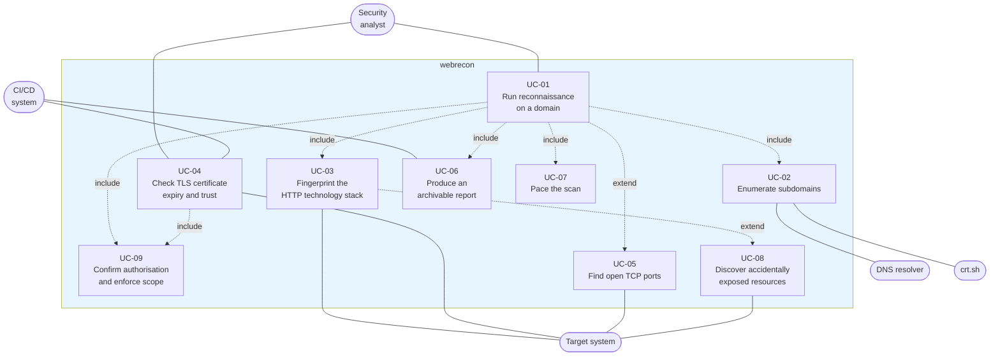

# 2. Use cases

| | |
| --- | --- |
| Document | SDD-02 — Use case specification |
| System | webrecon 0.2.0 |
| Status | Approved |
| Last revised | 2026-11-16 |

## 2.1 Actors

| Actor | Type | Description |
| --- | --- | --- |
| Security analyst | Primary, human | Runs the scan from the command line, confirms authorisation and interprets the report. Holds written authorisation to test the target. |
| CI/CD system | Primary, automated | Invokes webrecon non-interactively (`--i-have-authorization -q -o report.json`) to monitor exposed surface or certificate expiry. |
| DNS resolver | Secondary | The resolution service configured in the operating system, or the servers given with `--resolver`. |
| crt.sh | Secondary | Public Certificate Transparency log aggregator, queried read-only. |
| Target system | Secondary | The host under reconnaissance. |

## 2.2 Use case diagram



`include` relationships denote behaviour always executed as part of the base
case; `extend` relationships denote conditional behaviour, triggered either by
an option (`-m ports`) or by a condition encountered during execution (an
exposed file being present). UC-09 is included by every use case that contacts
the target actively.

## 2.3 Traceability matrix

| Use case | Realised by | CLI option | Tests |
| --- | --- | --- | --- |
| UC-01 | `scanner.run_scan`, `cli.main` | base command, `-iL`, `--max-time` | `TestRunScan`, `TestEndToEnd`, `TestPartialReports` |
| UC-02 | `dns_enum.enumerate_subdomains` | `-m subdomains`, `-w`, `--no-wordlist`, `--no-passive`, `--max-subdomains`, `--resolver` | `TestParseCrtsh`, `TestHostileCrtsh`, `TestSelectCandidates`, `TestEnumerateSubdomains`, `TestLoadWordlist`, `TestWordlistEdgeCases` |
| UC-03 | `http_probe.probe_hosts`, `tech_detect.detect`, `security_headers.analyse` | `-m http`, `--verify-tls`, `--proxy`, `--user-agent`, `--no-redact` | `TestProbeUrl`, `TestProbeHosts`, `TestTechDetect`, `TestTechDetectFalsePositives`, `TestExtractTitle`, `TestTitleEdgeCases`, `TestSecurityHeaders`, `TestRedaction` |
| UC-04 | `tls_info.inspect_hosts` | `-m tls` | `TestInspect`, `TestParseCertificate` |
| UC-05 | `port_scan.scan` | `-m ports`, `-p`, `--banners` | `TestCheckPort`, `TestScan`, `TestSanitiseBanner`, `TestParsePorts` |
| UC-06 | `report.write_json`, `report.write_html`, `report.JsonlWriter`, `report.render_terminal` | `-o`, `--html`, `--jsonl`, `--json`, `--force`, `-q`, `--fail-if-unreachable` | `TestJson`, `TestHtml`, `TestTerminalRender`, `TestErrorsAreVisible`, `TestReportFiles` |
| UC-07 | `ratelimit.Throttle`, `context.ScanContext`, `http_probe.RequestBudget` | `-r`, `-c`, `-t`, `--max-requests-per-host` | `TestThrottle`, `TestThrottleCancellation`, `TestRunScan::test_every_module_shares_one_throttle`, `TestNumericOptions` |
| UC-08 | `http_probe.discover_content` | implicit in `-m http` | `TestLooksLikeHit`, `TestSoftNotFoundGuard`, `TestParseRobots`, `TestDiscoverContent` |
| UC-09 | `targets.parse_target`, `targets.Scope`, `scanner._target_refusal`, `cli._confirm` | `--i-have-authorization`, `--operator`, `--scope`, `--scope-file`, `--allow-private` | `TestParseTarget`, `TestScope`, `TestTargetGate`, `TestUsageErrors` |

---

## 2.4 Detailed specifications

### UC-01 — Run reconnaissance on a domain

| | |
| --- | --- |
| **Primary actor** | Security analyst |
| **Preconditions** | The analyst holds written authorisation to test the domain; webrecon is installed; the system has network connectivity. |
| **Postconditions** | A `ScanReport` with `finished_at` populated and `complete` set has been produced for each target, displayed in the terminal and optionally written to file. |
| **Trigger** | `webrecon example.com` |

#### Main flow

1. The analyst invokes the command with one or more targets (positional
   arguments and/or `-iL FILE`).
2. The system parses each target into host, optional port and optional scheme,
   rejecting invalid hostnames, public suffixes and unsupported schemes.
3. The system validates the options, the scope entries, the wordlist and the
   output paths, all before any network traffic.
4. The system obtains the analyst's confirmation of authorisation (UC-09).
5. For each target the system builds a scan configuration and runs the stages
   through one shared scan context.
6. The system resolves the domain's DNS records.
7. The system checks that the target itself may be contacted (scope and
   address policy).
8. The system enumerates subdomains (UC-02).
9. If enabled, the system scans the target's TCP ports (UC-05); open web ports
   become additional HTTP and TLS endpoints.
10. The system probes the resolved hosts over HTTP (UC-03).
11. The system inspects the TLS certificates of reachable HTTPS endpoints
    (UC-04).
12. The system marks the report complete, records the finish time and renders
    the report (UC-06).

#### Alternative flows

| Id | Condition | Behaviour |
| --- | --- | --- |
| A1 | The domain resolves no records | `DnsRecords.error` names the cause (NXDOMAIN, timeout, SERVFAIL or generic), the string is appended to `ScanReport.errors`, and the scan continues with the remaining modules. |
| A2 | Enumeration yields no usable subdomains | The system falls back to the target as the only host to probe. |
| A3 | No host answers over HTTPS | The TLS probe falls back to the target on its given port (default 443), so an outcome is still reported. |
| A4 | The analyst interrupts with Ctrl-C | The system prints `interrupted; writing a partial report`, marks unfinished reports with `incomplete_reason`, writes the requested report files with what was gathered, and exits with code 130. |
| A5 | A requested module does not exist | `resolve_modules` rejects it listing the valid modules; the CLI exits with code 2 before any network traffic. |
| A6 | `--max-time` elapses | The running stage is cancelled, the report is returned with `complete=False` and `incomplete_reason` set, and the scan moves to the next target. |
| A7 | A stage raises an unexpected exception | The exception is recorded in `ScanReport.errors` as `stage: Type: message`; results from other stages are kept. |
| A8 | The target is out of scope or resolves only to non-public addresses | Active stages are skipped, the target is listed in `ScanReport.skipped` and an error explains why (UC-09). |
| A9 | The target includes a port or scheme (`example.com:8443`, `http://host`) | The HTTP and TLS stages use that port and scheme for the target. |
| A10 | An unexpected exception escapes the scan | The CLI prints `scan crashed`, writes the partial reports and exits with code 1. |

---

### UC-02 — Enumerate subdomains

| | |
| --- | --- |
| **Primary actor** | Security analyst |
| **Secondary actors** | crt.sh, DNS resolver |
| **Preconditions** | The `subdomains` module is enabled and the target is a domain name, not an IP address. |
| **Postconditions** | `ScanReport.subdomains` contains only in-scope hosts that actually resolve, each tagged with its source. |

#### Main flow

1. The system takes the hosts named by the target's MX and NS records (from
   the DNS stage, or queried now if that stage did not run) and keeps those
   inside the scope as candidates labelled `mx` or `ns`; third-party mail and
   DNS providers are dropped silently.
2. If passive mode is on, the system queries crt.sh for certificates issued on
   the domain, sending its User-Agent and, if configured, through the proxy.
3. The system normalises the returned names: lowercase, wildcards stripped,
   anything that is not a valid hostname or lies outside the target domain
   discarded.
4. Unless `--no-wordlist` is given, the system generates `word.domain`
   candidates from the supplied wordlist or, by default, the bundled one.
5. The system adds the apex domain to the candidate set, labelled `target`.
6. The system drops candidates outside the scope, recording them as skipped.
7. The system resolves a few random labels to detect a wildcard zone.
8. The system orders candidates by source confidence and applies the
   `--max-subdomains` cap.
9. The system resolves the A and AAAA records of each candidate, one throttle
   slot per query.
10. The system discards candidates that do not resolve, and wordlist candidates
    that resolve only to the wildcard addresses, and returns the rest in
    alphabetical order.

#### Alternative flows

| Id | Condition | Behaviour |
| --- | --- | --- |
| A1 | crt.sh does not answer, returns an HTTP error, or answers with something other than JSON | The failure is recorded in `ScanReport.errors`; the system proceeds with wordlist candidates. |
| A2 | The wordlist path does not exist or is not a file | `cli.main` terminates before the scan with an explicit message (exit 2). |
| A3 | Candidates exceed the cap | Survivors, in order: apex domain, MX/NS and crt.sh names, wordlist names. |
| A4 | A candidate resolves over IPv6 only | It is included normally; `addresses` holds only the AAAA addresses. |
| A5 | The zone has a wildcard record | A note reports the wildcard addresses and how many wordlist candidates were discarded; crt.sh names are kept. |
| A6 | Lookups time out or the server fails | Those candidates are dropped and a note reports how many could not be resolved. |
| A7 | A subdomain resolves only to non-public addresses | It is reported but not probed, and listed in `skipped` (unless `--allow-private`). |

---

### UC-03 — Fingerprint the HTTP technology stack

| | |
| --- | --- |
| **Primary actor** | Security analyst |
| **Preconditions** | At least one endpoint is available to probe. |
| **Postconditions** | Each endpoint has an `HttpResult` recording reachability and, when reachable, status, title, headers (secrets redacted), detected technologies and security findings. |

#### Main flow

1. For each endpoint the system chooses the scheme order: the explicit scheme
   if one was given, otherwise both, HTTP first on ports where plain HTTP is
   the norm and HTTPS first elsewhere. Every endpoint is tested on the same
   schemes, so hosts are compared on equal terms.
2. The system manually follows up to five redirects, recording the status and
   destination of each, and refuses to follow destinations outside the scope.
3. From the final response the system extracts status, final URL, title,
   `Server` header and content length.
4. The system collects the headers, keeping repeated `Set-Cookie` headers
   separate and redacting cookie values and credentials.
5. The system matches headers, cookies and body against the technology
   signatures and collects the hits, without duplicates.
6. The system checks the security headers and cookie flags and records findings,
   unless the page is a placeholder (default server page, parked domain,
   coming-soon page, empty body): that gets a note instead.
7. The system runs content discovery against the host (UC-08).
8. The system checks the scheme it did not fully probe with one request and
   records each scheme's outcome in `HttpResult.schemes`. On default ports a
   site served over HTTP only, or plain HTTP serving content instead of
   redirecting to HTTPS, is a finding.

#### Alternative flows

| Id | Condition | Behaviour |
| --- | --- | --- |
| A1 | The first scheme fails | The system probes the other in full; if that fails too it returns the first result, which carries the original error, with `timed_out` set when every attempt timed out. |
| A2 | Redirects exceed the limit | `HttpResult.error` reports `too many redirects` and the host is marked unreachable. |
| A3 | A redirect returns to a URL already visited | `HttpResult.error` reports `redirect loop at …` and the host is marked unreachable. |
| A4 | A redirect points outside the scope | It is recorded in `redirects` and in `notes` (not `findings`), the destination is listed in `skipped`, and the redirect response gets only the cookie checks: missing headers on a redirect say nothing about the site. |
| A5 | The response exceeds 256 KB | The body is truncated before analysis; headers and status remain intact. |
| A6 | No signature matches | `technologies` stays empty: the system makes no claim it cannot evidence. |
| A7 | The per-host request budget is exhausted | `HttpResult.error` reports `per-host request budget exhausted`; content discovery stops for that host. |
| A8 | `--no-redact` is given | Cookie and credential header values are kept verbatim in the report. |

---

### UC-04 — Check TLS certificate expiry and trust

| | |
| --- | --- |
| **Primary actors** | Security analyst, CI/CD system |
| **Preconditions** | The `tls` module is enabled. |
| **Postconditions** | Issuer, subject, SANs, validity window, days remaining, trust status, protocol, cipher and findings are available for each endpoint. |

#### Main flow

1. The system selects the endpoints that answered over HTTPS, plus open TLS
   ports found by the port scan.
2. For each in-scope endpoint it opens a connection and completes a verified
   handshake against the system trust store.
3. The system reads the peer certificate in DER form, the negotiated protocol
   and the cipher.
4. The system decodes the certificate, computes the days remaining and marks
   it valid only if the current instant lies between `notBefore` and
   `notAfter`.
5. The system records trust status and findings (expiry soon, expired, not yet
   valid, self-signed, legacy protocol).

#### Alternative flows

| Id | Condition | Behaviour |
| --- | --- | --- |
| A1 | The verified handshake fails verification (self-signed, expired, hostname mismatch) | The reason is stored in `verify_error`, `trusted` is `False`, and an unverified handshake retrieves the certificate: the anomalous certificate is the finding, not an error to hide. |
| A2 | The host accepts no connection on the port, or the handshake times out | `TlsInfo.error` records the cause; other endpoints are unaffected. |
| A3 | The certificate cannot be decoded | `TlsInfo.error` reports `unparseable certificate`. |
| A4 | The certificate expires within 30 days | A finding is recorded; terminal rendering highlights fewer than 15 days in red. |
| A5 | The endpoint is out of scope | It is not contacted; `TlsInfo.error` reads `skipped: …` and the host is listed in `skipped`. |

---

### UC-05 — Find open TCP ports

| | |
| --- | --- |
| **Primary actor** | Security analyst |
| **Preconditions** | The `ports` module is explicitly enabled (it is not part of the default profile). |
| **Postconditions** | `ScanReport.ports` lists only the open ports, sorted, each with its conventional service name and, optionally, a sanitised banner. |

#### Main flow

1. The system parses the port specification, which accepts lists and ranges.
2. The system resolves the target once, preferring IPv4, so every port
   connects to the same address.
3. For each port it opens a full TCP connection within the timeout.
4. If `--banners` is given, it reads up to 256 bytes and keeps a printable,
   bounded rendering.
5. The system closes every successful connection cleanly.
6. The system returns only the ports whose connection succeeded; open web
   ports are handed to the HTTP and TLS stages.

#### Alternative flows

| Id | Condition | Behaviour |
| --- | --- | --- |
| A1 | The port specification is malformed, non-ASCII or outside 1–65535 | `argparse` rejects the argument before the scan starts (exit 2), without expanding the range. |
| A2 | The connection times out or is refused | The port is treated as closed and omitted from the report. |
| A3 | The target does not resolve | `HostResolutionError` is recorded in `ScanReport.errors` as a `ports:` entry, rather than reported as "no open ports". |

> This is a *connect* scan: it completes the handshake and is therefore fully
> recorded in the target's logs. That is the correct behaviour for a tool aimed
> at systems you are authorised to test.

---

### UC-06 — Produce an archivable report

| | |
| --- | --- |
| **Primary actors** | Security analyst, CI/CD system |
| **Postconditions** | The report is available in the requested formats; the exit code reflects the outcome. |

#### Main flow

1. While the scan runs, if `--jsonl` was requested, the system appends one
   flushed JSON line per result.
2. At the end of the scan the system renders a status panel and tables for the
   non-empty sections in the terminal, including errors, unreachable hosts,
   findings, skipped hosts and notes.
3. If requested, it serialises the report to JSON using the dataclass schema
   (an object for one target, an array for several), to a file and/or stdout.
4. If requested, it generates a self-contained HTML document with no external
   assets and a restrictive Content-Security-Policy.
5. The system creates every file with mode `0600` and confirms the written
   paths on stderr.

#### Alternative flows

| Id | Condition | Behaviour |
| --- | --- | --- |
| A1 | Quiet mode or `--json` is active | Terminal rendering and progress messages are skipped; files are still written. |
| A2 | A section is empty | Its table is not emitted, neither in the terminal nor in HTML. |
| A3 | The target returns a title or banner containing markup | The value is escaped before insertion into HTML or rich output. |
| A4 | An output file already exists | The CLI refuses before scanning (exit 2) unless `--force` is given. |
| A5 | The output directory does not exist, or the path is a directory | The CLI refuses before scanning (exit 2). |
| A6 | Writing fails at the end | The CLI reports `could not write report` and exits with code 1. |
| A7 | `--fail-if-unreachable` is given and no target answered | The reports are still written; the exit code is 3. |

---

### UC-07 — Pace the scan

| | |
| --- | --- |
| **Primary actor** | Security analyst |
| **Preconditions** | The target enforces traffic limits, or the rules of engagement prescribe a request ceiling. |
| **Postconditions** | At no point does the scan exceed the configured concurrency and rate, across all modules together. |

#### Main flow

1. The analyst specifies maximum concurrency and requests per second.
2. The system builds one throttle for the scan and hands it to every stage.
3. Every network call — each DNS query, the crt.sh request, each HTTP request,
   each TLS handshake, each port connection — acquires a slot from the
   semaphore.
4. If a rate limit is active, the call waits for its turn in the token bucket
   before starting.
5. On completion, whether successful or not, the slot is released.

#### Alternative flows

| Id | Condition | Behaviour |
| --- | --- | --- |
| A1 | The rate is set to 0 | The token bucket is disabled; only the concurrency limit remains. |
| A2 | The call raises an exception or is cancelled | The slot is released regardless: the throttle cannot deadlock. |
| A3 | Parameters are out of range (concurrency < 1, rate < 0, timeout ≤ 0) | `argparse` rejects them before the scan (exit 2); `Throttle` also raises `ValueError` at construction when used as a library. |
| A4 | `--max-requests-per-host N` is given | Each host receives at most N HTTP requests; further requests are not sent. |
| A5 | `--max-time` is given | The scan of each target stops after that many seconds with a partial report. |

---

### UC-08 — Discover accidentally exposed resources

| | |
| --- | --- |
| **Primary actor** | Security analyst |
| **Type** | Extension of UC-03 |
| **Postconditions** | `HttpResult.interesting_paths` lists the paths that are actually present. |

#### Main flow

1. The system requests a random non-existent path to record what the server
   returns for a missing resource (the baseline).
2. The system requests the well-known paths: `robots.txt`, `sitemap.xml`,
   `security.txt`, `.git/HEAD`, `.env`.
3. For each response with status 200 it verifies the body differs from the
   baseline and has the shape expected for that file type.
4. If `robots.txt` is present, it extracts its directives and reports their
   paths, up to a maximum of twenty.

#### Alternative flows

| Id | Condition | Behaviour |
| --- | --- | --- |
| A1 | The server answers 200 with an HTML error page (soft 404) | The shape check rejects the hit: a genuine `.git/HEAD` is a `ref:` line or a commit hash, a genuine `.env` contains `KEY=value` lines and is not HTML or JSON, a genuine `robots.txt` has robots directives. |
| A2 | The server answers every path with the same body | The baseline comparison rejects every hit. |
| A3 | `robots.txt` contains only `Disallow: /` | No path is extracted: the value carries no information. |

> None of the requests in this use case is an exploit attempt: they are all GET
> requests to paths that servers either publish deliberately or leave readable
> through misconfiguration.

---

### UC-09 — Confirm authorisation and enforce scope

| | |
| --- | --- |
| **Primary actors** | Security analyst, CI/CD system |
| **Preconditions** | At least one active module (`subdomains`, `http`, `tls`, `ports`) is enabled. |
| **Postconditions** | `ScanReport.authorization` records operator, instant, method and scope; no host outside the scope, and no non-public address without opt-in, has been contacted. |

#### Main flow

1. The system builds the scope from `--scope` and `--scope-file`, or defaults to
   each target and its subdomains, validating every entry.
2. If `--i-have-authorization` is given, the confirmation method is `flag`.
3. Otherwise, on an interactive terminal, the system shows targets, scope,
   modules and the crt.sh disclosure, and asks the analyst to type `yes`.
4. The system records the operator (from `--operator` or the login name).
5. Before the active stages, the system checks the target against the scope
   and resolves it to verify it has at least one public address.
6. During the scan, every subdomain, redirect destination and TLS endpoint is
   checked against the scope before it is contacted.

#### Alternative flows

| Id | Condition | Behaviour |
| --- | --- | --- |
| A1 | The analyst answers anything other than `yes` | `not confirmed; nothing was scanned`; exit code 2. |
| A2 | Standard input is not a terminal and the flag is absent | The CLI refuses with a usage error (exit 2) before any traffic. |
| A3 | A scope entry is not a valid domain or CIDR | The CLI refuses with `invalid scope entry` (exit 2). |
| A4 | The target is an IP literal or a name resolving only to loopback, private or link-local addresses | Active stages are skipped and the reason is recorded, unless `--allow-private` is given. |
| A5 | Only the `dns` module is enabled | No confirmation is requested and `authorization` stays `null`: nothing is sent to the target itself. |

## 2.5 Operational scenarios

**Initial reconnaissance on an authorised perimeter.** The analyst runs the full
profile with the bundled wordlist, records their name and produces every report
format, to be attached to the engagement report.

```bash
webrecon example.com -m all --operator "J. Analyst" \
    -r 10 -c 5 --max-time 600 \
    -o report.json --jsonl report.jsonl --html report.html
```

**Continuous certificate monitoring.** A nightly pipeline runs the TLS module
alone in quiet mode, confirming authorisation by flag since no terminal is
attached, and evaluates the days remaining and trust status with `jq`.

```bash
webrecon example.com -m tls --i-have-authorization -q --force -o tls.json
jq '.tls[] | select(.days_until_expiry < 30 or .trusted == false)
    | {host, port, days_until_expiry, verify_error}' tls.json
```

**Verifying a reported exposure.** The analyst restricts the scan to the HTTP
module on a single endpoint to confirm quickly whether a resource is publicly
readable, without generating additional DNS traffic and printing JSON to stdout.

```bash
webrecon https://app.example.com:8443 -m http --i-have-authorization --json \
    | jq '.http[] | {url, interesting_paths, findings}'
```

**Scanning a list of hosts within a declared perimeter.** The analyst reads
targets from a file and constrains the scan to the perimeter in the rules of
engagement; anything else that turns up is listed as skipped.

```bash
webrecon -iL targets.txt --scope-file scope.txt -m http,tls \
    --max-requests-per-host 20 --fail-if-unreachable -o perimeter.json
```

## 2.6 Legitimacy constraints

Every use case that interacts with the target system carries, as a
non-negotiable precondition, the written authorisation of that system's owner.
Unauthorised scanning of third-party systems is a criminal offence in most
jurisdictions, including Italy (art. 615-*ter* of the penal code, unauthorised
access to a computer system). Since 0.2.0 the tool enforces this precondition
procedurally (UC-09): it asks for an explicit confirmation, records who gave it
and when, and refuses to leave the declared scope. The confirmation does not
replace the written authorisation; it documents that the operator asserted
having it.

The DNS module (`-m dns`) and UC-02 in passive mode query only resolvers and
public third-party sources, generating no traffic towards the target's hosts —
with one exception: the opt-in `--axfr` attempt contacts the domain's
authoritative name servers, which may belong to the target organisation. Note that passive mode discloses the target name to crt.sh; `--no-passive`
disables it, and the interactive confirmation mentions it.
