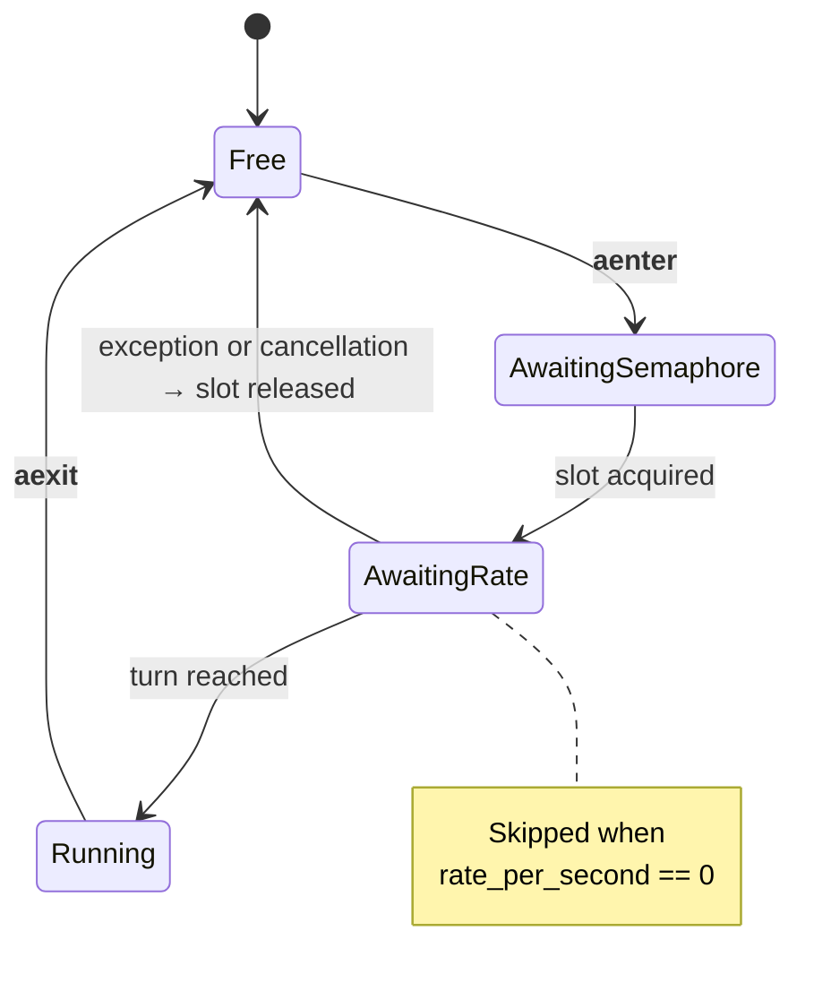
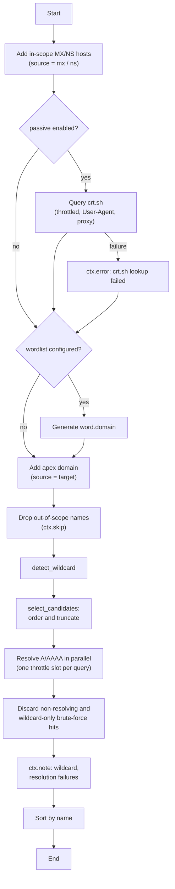
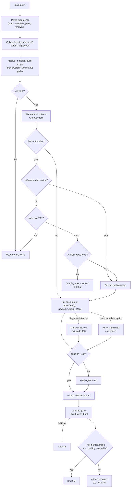

# 3. Function reference

| | |
| --- | --- |
| Document | SDD-03 — Detailed component specification |
| System | webrecon 0.2.0 |
| Status | Approved |
| Last revised | 2026-11-16 |

## 3.1 Purpose and conventions

This document describes every function, class and public constant in the
system: what it does, how it behaves at the edges, and which errors it handles.

Conventions used:

- Names beginning with `_` are private to their module and not part of the
  public interface: they are documented because they carry meaningful logic,
  but may change without notice.
- Functions marked **async** are coroutines and must be awaited.
- "Does not raise" means the expected errors (network, parsing) are caught and
  turned into return values; programming errors (`TypeError`, `AttributeError`)
  propagate normally.
- The test reference names the class covering that function in `tests/`.
- Sections §3.3–§3.15 keep the numbering of the first issue, so that external
  references stay valid; the modules introduced in 0.2.0 are described in
  §3.16–§3.18.

## 3.2 Module map

```mermaid
graph LR
    subgraph pure["Pure logic (testable offline)"]
        P1["extract_title / parse_robots"]
        P2["collect_headers / redact_cookie"]
        P3["parse_crtsh / load_wordlist"]
        P4["select_candidates / summarise_failure"]
        P5["detect / parse_cookies"]
        P6["analyse / cookie_attributes"]
        P7["parse_certificate / parse_der"]
        P8["to_json / to_html"]
        P9["parse_ports / parse_target / Scope"]
        P10["sanitise_banner"]
    end

    subgraph io["I/O logic (loopback servers in tests)"]
        I1["fetch_records"]
        I2["enumerate_subdomains"]
        I3["probe_url / probe_hosts"]
        I4["inspect / inspect_hosts"]
        I5["check_port / scan"]
    end

    subgraph orch["Orchestration (stubbed modules in tests)"]
        O1["run_scan"]
        O2["cli.main"]
    end

    orch --> io
    io --> pure

    style pure fill:#ebfbee
    style io fill:#fff4e6
    style orch fill:#e7f5ff
```

The separation is deliberate: decision logic is isolated in pure functions,
which are tested directly. The I/O functions are exercised against real
loopback HTTP, TLS and DNS servers started by the fixtures in
`tests/conftest.py`, so the network code is tested without leaving the machine.
The orchestrator is tested with the I/O functions replaced by stubs, and
`cli.main` end to end against a loopback HTTP server. In total 275 tests run in
about four and a half seconds with no internet access.

---

## 3.3 `webrecon/__init__.py`

The main package. Exposes only the `__version__` constant (currently `"0.2.0"`),
which is the **single source of truth** for the version: `pyproject.toml`
declares `dynamic = ["version"]` and reads the attribute at build time through
`[tool.setuptools.dynamic] version = { attr = "webrecon.__version__" }`, and
`config.USER_AGENT` and `webrecon --version` embed it. It imports no
submodules, so `import webrecon` stays fast and free of side effects.

*Tests:* `tests/test_packaging.py` — the User-Agent carries the version and
`pyproject.toml` reads it from the package.

## 3.4 `webrecon/__main__.py`

Entry point for `python -m webrecon`. Delegates entirely to `cli.main` and
propagates its return value as the process exit code. It exists alongside the
`webrecon` entry point declared in `pyproject.toml` so the tool can be run from
source without installation.

---

## 3.5 `webrecon/config.py`

### Configuration constants

| Name | Value | Role |
| --- | --- | --- |
| `DEFAULT_PORTS` | 15 common ports (21, 22, 25, 53, 80, 110, 143, 443, 445, 3306, 3389, 5432, 8000, 8080, 8443) | Default list for the `ports` module. Deliberately short: scanning the full port space is not an acceptable default behaviour. |
| `WEB_PORTS` | 80, 443, 3000, 5000, 8000, 8008, 8080, 8443, 8888, 9443 | Ports on which an open TCP port is worth an HTTP(S) probe and, for the TLS ones, a certificate inspection. |
| `USER_AGENT` | `webrecon/<__version__> (+project URL)` | Identifies the tool in the target's logs. Declaring your identity is part of conducting authorised reconnaissance properly. Built from `__version__`, so it cannot drift from the package version. |
| `BUNDLED_WORDLIST_NAME` | `subdomains-small.txt` | File name of the wordlist shipped in `webrecon/data/`. |

### `bundled_wordlist() -> Traversable`

Returns the bundled wordlist through `importlib.resources`, so it is found from
a wheel, an editable install or a source checkout alike. It replaces the
`wordlists/` directory of 0.1.0, which existed only in a source checkout. The
file is declared as package data in `pyproject.toml`.

*Tests:* `tests/test_packaging.py::test_bundled_wordlist_is_reachable_through_importlib_resources`

### `class ScanConfig`

Dataclass holding every parameter of a run for **one** target. Built by
`cli.main` once per target and passed by reference to the modules, none of
which modify it.

| Field | Type | Default | Meaning |
| --- | --- | --- | --- |
| `target` | `str` | required | Already-parsed host: ASCII hostname or compressed IP literal. |
| `port` | `int \| None` | `None` | Port given in the target (`host:port` or URL); used by the HTTP and TLS stages for the target. |
| `scheme` | `str \| None` | `None` | Scheme given in the target URL (`http` or `https`); forces that scheme for the target's HTTP probe. |
| `wordlist` | `Path \| Traversable \| None` | `None` | Wordlist for subdomain brute-force. The CLI passes the bundled list unless `-w` or `--no-wordlist` is given. |
| `concurrency` | `int` | `20` | Maximum simultaneous network operations, across all modules. |
| `rate_per_second` | `float` | `0.0` | Ceiling on operations per second across all modules; `0` disables pacing. |
| `timeout` | `float` | `5.0` | Per-operation timeout, in seconds. |
| `modules` | `set[str]` | `{dns, subdomains, http, tls}` | Enabled modules. `ports` is excluded from the default profile. |
| `ports` | `list[int]` | `DEFAULT_PORTS` | Ports to scan. |
| `passive` | `bool` | `True` | Enables Certificate Transparency log queries. |
| `max_subdomains` | `int` | `200` | Cap on candidates resolved; `0` for no cap. |
| `user_agent` | `str` | `USER_AGENT` | `User-Agent` header on HTTP requests and on the crt.sh query. |
| `verify_tls` | `bool` | `False` | Certificate verification on HTTP probes; off by default (ADR-04). |
| `proxy` | `str \| None` | `None` | HTTP(S) proxy for HTTP probes and crt.sh only. |
| `scope` | `list[str]` | `[]` | Scope entries (domains, `*.domain`, CIDRs); empty means the target and its subdomains. |
| `allow_private` | `bool` | `False` | Allows loopback, private, link-local and other non-public addresses. |
| `max_time` | `float \| None` | `None` | Upper bound on the duration of the scan, in seconds. |
| `max_requests_per_host` | `int` | `0` | HTTP request budget per host; `0` is unlimited. |
| `banners` | `bool` | `False` | Reads a sanitised banner from each open port. |
| `axfr` | `bool` | `False` | Attempts a DNS zone transfer. |
| `redact` | `bool` | `True` | Redacts cookie values and credential headers in the report. |
| `nameservers` | `list[str]` | `[]` | DNS servers to use instead of the system resolver. |
| `dns_port` | `int` | `53` | Port of those DNS servers (used by the loopback tests). |

#### `enabled(module: str) -> bool`

Reports whether a module is active for this run. The class's only method; it
exists so the orchestrator never inspects the `modules` set directly.

---

## 3.6 `webrecon/models.py`

Defines the data contract between the collection modules and the presentation
layer. All classes are behaviour-free dataclasses, except for
`ScanReport.to_dict` and `ScanReport.anything_reachable`.

### `_utcnow() -> str`

Returns the current instant in UTC as ISO 8601 with second resolution. It is the
default factory for `ScanReport.started_at`. Using UTC explicitly prevents
reports produced in different time zones from being incomparable.

### Result dataclasses

| Class | Produced by | Contents |
| --- | --- | --- |
| `DnsRecords` | `dns_enum.fetch_records` | Domain; type → values map (only types with at least one value, plus `DMARC` and `DKIM` when found); `status`, type → outcome (`OK`, `NOANSWER`, `NXDOMAIN`, `TIMEOUT`, `SERVFAIL`, `ERROR`, plus `DMARC` and `AXFR` entries); `findings` (mail and AXFR); optional error. |
| `Subdomain` | `dns_enum.enumerate_subdomains` | Hostname, resolved addresses, discovery source (`target`, `mx`, `ns`, `crt.sh`, `bruteforce`). |
| `Redirect` | `http_probe.probe_url` | Status and destination of a single hop in the redirect chain. |
| `HttpResult` | `http_probe.probe_url` | Full probe outcome: reachability, status, title, headers (redacted by default), redirect chain, final URL, technologies, interesting paths, security `findings`, informational `notes`, per-scheme outcomes (`schemes`), `timed_out`, error. |
| `TlsInfo` | `tls_info.inspect` | Host, port, validity, issuer, subject, validity window, days remaining, SANs (DNS and IP), `trusted`, `verify_error`, `protocol`, `cipher`, findings, error. |
| `PortResult` | `port_scan.check_port` | Port, open state, conventional service name, optional sanitised banner. |
| `SkippedHost` | `context.ScanContext.skip` | Host that was deliberately not contacted, and why (out of scope, non-public address, redirect target). |
| `ScanReport` | `scanner.run_scan` | Aggregate of all the above, plus target, start and finish instants, `complete` and `incomplete_reason`, `scope`, `authorization`, `settings`, `skipped`, `notes` and scan-level `errors`. |

`TlsInfo.trusted` is tri-state: `True` when chain and hostname verified against
the system trust store, `False` when they did not (see `verify_error`), `None`
when no handshake completed.

#### `ScanReport.to_dict() -> dict`

Recursively converts the whole report into native structures via
`dataclasses.asdict`. It is the single point where a whole report leaves its
typed form, which makes the JSON schema a direct consequence of the definitions
above.

**Edge behaviour.** A report with no results yields empty lists and `dns: null`,
never missing keys: automated consumers can rely on every field being present.

*Tests:* `tests/test_report.py::TestJson`

#### `ScanReport.anything_reachable() -> bool`

True when at least one HTTP result is reachable, one port is open, or one TLS
inspection completed without error. Used by `--fail-if-unreachable`.

---

## 3.7 `webrecon/ratelimit.py`

### `class Throttle`

Combines a concurrency limit and a rate limit behind a single async context
manager interface. Since 0.2.0 every network call in the system passes through
it, and through the **same instance** for a given scan: `run_scan` builds one
`ScanContext` whose `Throttle` is used by DNS (one slot per query), crt.sh,
HTTP (one slot per request, redirects and content discovery included), TLS (one
slot per handshake), the target's address lookup, and the port scan (one slot
for the resolution and one per port). `--rate` and `--concurrency` are therefore
ceilings for the whole scan, not per module.

#### `__init__(concurrency: int = 20, rate_per_second: float = 0.0)`

Constructs the throttle. The semaphore is sized to `concurrency`; the token
bucket computes a minimum interval of `1 / rate_per_second`, or zero when the
rate is unlimited.

**Errors.** Raises `ValueError` for `concurrency < 1` or `rate_per_second < 0`.
Validation happens at construction because a malformed throttle would render
every subsequent control meaningless. The CLI rejects such values earlier,
through its numeric argument validators.

#### `_wait_for_slot() -> None` *(private, async)*

Implements the token bucket. Under the lock it computes the next available slot
and advances it by the minimum interval; the actual wait happens **outside** the
lock, so subsequent coroutines can book their own turn without serialising on
someone else's wait.

Returns immediately when the rate limit is disabled.

#### `__aenter__() -> Throttle` *(async)*

Acquires a slot from the semaphore, then waits for its turn in the token bucket.
If the wait is interrupted (task cancellation, `KeyboardInterrupt`, the
`--max-time` deadline), it releases the slot before propagating: the `except`
clause catches `BaseException` precisely to cover cancellation, which does not
derive from `Exception`.

#### `__aexit__(exc_type, exc, tb) -> None` *(async)*

Releases the semaphore slot. It does not suppress exceptions: an error in the
block body keeps propagating to the caller, which is the module responsible for
that particular network call.

*Tests:* `tests/test_ratelimit.py::TestThrottle` — verifies peak concurrency,
effective rate, release on exception, and parameter validation;
`TestThrottleCancellation` — a cancelled waiter releases its slot. The sharing
of one instance is verified by
`tests/test_scanner.py::TestRunScan::test_every_module_shares_one_throttle`,
and the effective rate per module against loopback servers by
`TestFetchRecords::test_respects_the_shared_rate`,
`TestProbeHosts::test_rate_applies_to_http_requests` and
`TestScan::test_respects_the_rate_limit`.

---

## 3.8 `webrecon/modules/dns_enum.py`

### `dns_enum` constants

| Name | Role |
| --- | --- |
| `RECORD_TYPES` | The eight record types queried: A, AAAA, MX, NS, TXT, CNAME, SOA, CAA. |
| `DKIM_SELECTORS` | Seven common DKIM selectors tried on domains that receive mail (DKIM keys cannot be enumerated, only guessed). |
| `CRT_SH_URL` | Endpoint of the Certificate Transparency service. |
| `CRT_SH_MIN_TIMEOUT` | 15 seconds: the minimum timeout for the crt.sh query, whatever `-t` says. |
| `WILDCARD_PROBES` | 3: number of random labels resolved to detect a wildcard zone. |

### `make_resolver(timeout, nameservers=None, port=53)`

Builds an async resolver setting both `timeout` (wait per attempt) and
`lifetime` (total wait). Setting only the former would leave the query free to
retry beyond the limit the user expects. With `nameservers` (from `--resolver`),
the system configuration is ignored and those servers are queried on `port`.

**Errors.** Raises `dns.resolver.NoResolverConfiguration` when no servers are
given and the system has no resolver configuration; `fetch_records` turns it
into an error entry.

### `query_status(exc) -> str`

Names the outcome of a failed query: `NXDOMAIN`, `NOANSWER`, `TIMEOUT`,
`SERVFAIL` (for `NoNameservers`, which also covers REFUSED) or `ERROR`. It is
what lets the report distinguish a non-existent domain from a resolver outage.

### `_query(resolver, name, rtype, throttle) -> tuple[str, list[str]]` *(private, async)*

Runs **one** query inside **one** throttle slot. Returns `("OK", sorted values)`
on success, or `(query_status(exc), [])` on any `DNSException`; it never raises
DNS errors. Every DNS lookup in the module goes through it, which is how the
shared rate applies to DNS.

### `summarise_failure(status) -> str`

Builds the `DnsRecords.error` message when no type returned values: `domain does
not exist (NXDOMAIN)` when every query was NXDOMAIN, `DNS queries timed out` or
`DNS server failure (SERVFAIL or REFUSED)` when that was the only kind of
failure and nothing answered, otherwise `no DNS records resolved`.

*Tests:* `tests/test_dns_io.py::test_summarise_failure_names_the_cause`

### `fetch_records(domain, timeout=5.0, throttle=None, nameservers=None, port=53, axfr=False) -> DnsRecords` *(async)*

Queries all record types in parallel and aggregates the results.

**Behaviour.** Each type is queried through `_query`, sharing the given throttle
(or a private one sized to the number of types when used as a library). The
outcome of every query is stored in `status`; types that return no values are
omitted from `records`, so the report does not fill up with empty keys. Values
are sorted to keep output reproducible across runs. When the domain has MX
records, `_mail_hints` adds DMARC and DKIM data and findings; with `axfr=True`
and NS records, `_attempt_axfr` tries a zone transfer.

**Error handling.** A missing resolver configuration yields `error = "no usable
DNS resolver: …"`. If no type produced results, `error` is set by
`summarise_failure`: without it, a non-existent domain and a resolver outage
would be indistinguishable from an empty report.

*Tests:* `tests/test_dns_io.py::TestFetchRecords` (against a loopback DNS server)

### `_mail_hints(result, resolver, throttle) -> None` *(private, async)*

Only for domains that receive mail. Flags a missing SPF record and an SPF record
containing `+all`; queries `_dmarc.<domain>`, stores it as `DMARC` and flags a
missing record or `p=none`; queries the `DKIM_SELECTORS` under `_domainkey` and
stores any keys found as `DKIM` (`selector: value`).

### `_attempt_axfr(result, resolver, timeout, throttle) -> None` *(private, async)*

For each NS record, resolves the server's address and attempts a zone transfer
in a worker thread (`dnspython`'s transfer API is synchronous) under a throttle
slot and an outer timeout of twice `timeout`. A success is a finding
(`zone transfer (AXFR) allowed by <ns>: <n> records`); `status["AXFR"]` is
`ALLOWED` if any server allowed it, otherwise `REFUSED`. Only the record count
is reported, never the zone contents.

### `_resolve_host(resolver, host, throttle) -> tuple[list[str], bool]` *(private, async)*

Resolves a single host's A and AAAA records and returns the deduplicated, sorted
addresses, plus whether a lookup failed abnormally (timeout, server failure,
other error, as opposed to a clean NXDOMAIN or empty answer). Each query takes
its own throttle slot; after an NXDOMAIN on A the AAAA query is skipped.

Returns an empty address list if the host does not resolve — the condition the
caller uses as an existence test.

### `load_wordlist(path: Path | Traversable) -> list[str]`

Reads a wordlist of subdomain labels.

**Behaviour.** Decodes as `utf-8-sig`, so a byte order mark is ignored; treats
`#` as the start of a comment anywhere on a line; lowercases, strips
surrounding whitespace and dots, discards blank lines and entries that are not
valid hostnames (`foo bar`, `*.x`), and removes duplicates while preserving
first-appearance order. Decoding uses `errors="ignore"`, because public
wordlists frequently contain invalid bytes that must not abort a whole scan.
Accepts both a filesystem path and the bundled `Traversable`.

*Tests:* `tests/test_parsing.py::TestLoadWordlist`, `TestWordlistEdgeCases`

### `parse_crtsh(payload: str, domain: str) -> set[str]`

Extracts hostnames from a crt.sh JSON response.

**Behaviour.** A single `name_value` field may hold several newline-separated
names, and wildcard certificates appear as `*.example.com`: both cases are
normalised. Both `name_value` and `common_name` are considered. Anything that is
not a valid hostname (e-mail addresses, `?` placeholders, spaces, slashes) is
discarded, and so are names outside the target domain — a certificate may list
third-party domains, which are not part of the authorised perimeter.

**Error handling.** Malformed JSON, a payload that is not a list, or entries that
are not objects yield an empty result rather than an exception.

*Tests:* `tests/test_parsing.py::TestParseCrtsh`, `TestHostileCrtsh`

### `passive_subdomains(domain, timeout=15.0, user_agent=USER_AGENT, throttle=None, proxy=None) -> set[str]` *(async)*

Queries crt.sh and delegates parsing to `parse_crtsh`. The request carries the
project User-Agent, takes a throttle slot, goes through `proxy` if given, and
ignores proxy environment variables (`trust_env=False`).

**Error handling.** Unlike 0.1.0, failures are **raised**, not swallowed:
`httpx.HTTPError` for network and HTTP status errors, `ValueError` for a body
that is not JSON. The caller records them, so "crt.sh failed" is never mistaken
for "crt.sh knows no names".

### `record_hosts(records) -> dict[str, str]`

Maps the hostnames named by MX and NS records to `"mx"` or `"ns"`: the MX
preference is dropped, names are lowercased without the trailing dot, and the
null MX (`0 .`) and other invalid names are discarded.

*Tests:* `tests/test_parsing.py::TestRecordHosts`

### `mail_and_name_servers(ctx, resolver) -> dict[str, str]` *(async)*

Returns `record_hosts` of the target, reusing the records of the DNS stage
when `ctx.report.dns` holds them and querying MX and NS otherwise.

### `select_candidates(candidates, domain, limit) -> list[str]`

Orders candidates by source confidence and applies the cap.

**Behaviour.** Sorting is by the pair (source priority, name), with priority
`target` < `mx` = `ns` = `crt.sh` < `bruteforce`. A non-positive limit returns
the whole set.

**Rationale.** Plain alphabetical truncation silently drops the apex domain and
passively discovered names that sort late — precisely the hosts most likely to
exist (ADR-05).

*Tests:* `tests/test_parsing.py::TestSelectCandidates`

### `detect_wildcard(resolver, domain, throttle) -> set[str]` *(async)*

Resolves `WILDCARD_PROBES` random labels (`wr-<16 hex>.<domain>`). Any address
returned means the zone answers for every name; the union of those addresses is
returned so the caller can discard brute-force hits that resolve only to them.

### `enumerate_subdomains(ctx: ScanContext) -> list[Subdomain]` *(async)*

The module's orchestrator: merges the sources, enforces the scope, selects
candidates, resolves them and returns only the hosts that exist.

**Behaviour.** Each found subdomain is passed to `ctx.emit("subdomain", …)` as
soon as it resolves. The apex is always relabelled `target`, even if crt.sh also
listed it. MX/NS hosts outside the scope (a hosted mail provider, the
registrar's name servers) are not candidates and are not listed as skipped.
MX/NS and crt.sh names that resolve only to wildcard addresses are kept,
because a record or a certificate is evidence of their existence; wordlist
guesses are not.

**Error handling.** A crt.sh failure becomes an `errors` entry and enumeration
proceeds. Each candidate is resolved under `asyncio.gather(…,
return_exceptions=True)`, so an unexpected exception on one host is recorded
and the others are kept. Candidates that could not be resolved because of
timeouts or server failures are counted in a note.

*Tests:* `tests/test_dns_io.py::TestEnumerateSubdomains` (against a loopback DNS
server, including a wildcard zone and an out-of-scope candidate)

---

## 3.9 `webrecon/modules/http_probe.py`

### `http_probe` constants

| Name | Value | Role |
| --- | --- | --- |
| `MAX_BODY_BYTES` | 256,000 | Cap on body characters analysed, to avoid consuming memory on huge responses. |
| `MAX_TITLE_SCAN` | 64,000 | Cap on the part of the body fed to the title parser. |
| `MAX_REDIRECTS` | 5 | Maximum hops followed. |
| `COMMON_PATHS` | 5 paths | Resources checked by content discovery. |
| `SENSITIVE_HEADERS` | `set-cookie`, `authorization`, `proxy-authorization` | Headers whose values are redacted by default. |
| `REDACTED` | `<redacted>` | Replacement text for redacted values. |
| `PLAIN_HTTP_PORTS` | 80, 3000, 5000, 8000, 8008, 8080, 8888 | Ports on which HTTP is tried before HTTPS. |

The `TITLE_RE` regular expression of 0.1.0 no longer exists.

### `class _TitleParser` *(private)*

An `html.parser.HTMLParser` subclass that finds the document title. It ignores
`<title>` elements nested inside `svg`, `math`, `script`, `style`, `template`
and `noscript`, keeps the first top-level title only, and decodes character
references (`convert_charrefs=True`).

### `extract_title(body: str) -> str | None`

Extracts an HTML page title.

**Behaviour.** Feeds at most `MAX_TITLE_SCAN` characters to `_TitleParser`;
entities are decoded (`&amp;` becomes `&`). An unterminated title still yields
its text. Collapses internal whitespace (a title indented across three lines
becomes one line) and truncates at 200 characters. Returns `None` if the tag is
absent or holds only whitespace. Handles tags with attributes
(`<title dir="ltr">`). Parser errors are swallowed.

*Tests:* `tests/test_parsing.py::TestExtractTitle`, `TestTitleEdgeCases`

### `parse_robots(body: str) -> list[str]`

Extracts the paths declared in a `robots.txt`.

**Behaviour.** Considers the `Disallow`, `Allow` and `Sitemap` directives,
ignoring comments and blank lines. Discards a bare `/`, which carries no
information, and deduplicates while preserving order.

**Security note.** A `robots.txt` is often an inadvertent index of the areas an
organisation considers sensitive: it is legitimate, public reconnaissance
material.

*Tests:* `tests/test_parsing.py::TestParseRobots`

### `redact_cookie(raw: str) -> str`

Replaces the value of one `Set-Cookie` header with `<redacted>`, keeping the
cookie name and its attributes (`sid=<redacted>; Path=/; HttpOnly`), which are
what the security analysis and the analyst need.

### `collect_headers(headers: httpx.Headers, redact=True) -> dict[str, str]`

Flattens response headers into the `HttpResult.headers` dictionary, with
lowercased names.

**Behaviour.** `httpx` joins repeated headers with `", "`, which corrupts
`Set-Cookie` because `Expires` dates contain commas. Each header is therefore
read with `headers.get_list`; repeated `Set-Cookie` values are joined with
**newlines**, other repeated headers with `", "`. With `redact=True` (the
default, disabled by `--no-redact`), cookie values are replaced through
`redact_cookie` and `Authorization` / `Proxy-Authorization` values with
`<redacted>`.

*Tests:* `tests/test_parsing.py::TestRedaction`

### `_looks_like_hit(response, path, baseline=None) -> bool` *(private)*

Distinguishes a genuine hit from a soft 404.

**Behaviour.** Requires status 200 and a non-empty body. A body identical to the
`baseline` (what the server returned for a random non-existent path) never
counts. Then applies a shape check specific to the file type:

| Path | Accepted when |
| --- | --- |
| `/.git/HEAD` | The whole body is `ref: refs/…` or a 40- or 64-hex-digit object id. |
| `/.env` | Not HTML, does not start with `<`, `{` or `[`, and contains a `KEY=` line (optionally `export KEY=`). |
| `/robots.txt` | Not HTML and contains a robots directive (`user-agent`, `disallow`, `allow`, `sitemap`, `crawl-delay`). |
| `security.txt` | Not HTML and contains a `Contact:` field. |
| `*.xml` | Contains a `<urlset>` or `<sitemapindex>` element, namespaced or not. |
| anything else | Not HTML. |

"HTML" is judged from the `Content-Type` and from markup at the start of the
body.

**Rationale.** Many servers answer 200 with a custom error page. Without this
filter the report would flag files that do not exist as exposed — the most
damaging kind of finding in a security report.

*Tests:* `tests/test_parsing.py::TestLooksLikeHit`, `TestSoftNotFoundGuard`

### `class RequestBudget`

Caps how many requests each host (`netloc`) may receive; `per_host=0` means
unlimited. `take(url) -> bool` consumes one unit and returns `False` once the
host's budget is exhausted. One instance is shared by all probes of a scan
(`--max-requests-per-host`).

### `_get(client, url, throttle, budget) -> httpx.Response | None` *(private, async)*

Every HTTP request of the module goes through here: it consults the budget,
returning `None` if exhausted, then sends the GET inside one throttle slot.

### `probe_url(client, url, throttle, discover_paths=True, scope=None, budget=None, redact=True, on_skip=None) -> HttpResult` *(async)*

Probes a single URL, following the redirect chain manually.

**Behaviour.** Redirects are not delegated to `httpx` because the chain itself
is reconnaissance data: every hop is recorded as a `Redirect` with status and
destination, and relative destinations are resolved against the current URL.
Before following a hop it checks that the scheme is HTTP(S), that the
destination host is allowed by `scope` and that the URL has not been visited
already. From the final response it extracts status, final URL, title, `Server`
header, headers (through `collect_headers`), technologies (through
`tech_detect.detect`, with the raw `Set-Cookie` list) and security findings
(through `security_headers.analyse`); if `content-length` is absent or not an
ASCII number, it falls back to the actual length of the downloaded body.

Findings and notes are kept apart. A placeholder page (`placeholder_kind`)
gets the note `<kind>; security headers not checked` and no header or cookie
findings. When the chain stopped on a redirect (out of scope, non-HTTP scheme,
no `Location`) only the cookie checks run, with the note `redirect not
followed; security headers not checked`.

**Error handling.**

| Condition | Outcome |
| --- | --- |
| Destination out of scope | The hop is recorded, a note `redirect to <host> not followed (<reason>)` is added, `on_skip` is called, and the current response is analysed (cookies only). |
| Destination already visited | `error = "redirect loop at <url>"`, unreachable. |
| More than `MAX_REDIRECTS` hops | `error = "too many redirects"`, unreachable. |
| Budget exhausted | `error = "per-host request budget exhausted"`, unreachable. |
| `httpx.HTTPError`, `InvalidURL`, `UnicodeError`, `ValueError` | Recorded in `error` with type and message; `timed_out` is set for `httpx.TimeoutException`. |

*Tests:* `tests/test_http_io.py::TestProbeUrl` (against a loopback HTTP server)

### `placeholder_kind(body) -> str | None`

Names the kind of placeholder a page is — `empty page`, `nginx default page`,
`Apache default page`, `IIS default page`, `web server default page`,
`hosting placeholder`, `parked domain`, `coming-soon page` — or returns `None`
for a real page. Patterns are matched on the first 64 KB of the body; the
coming-soon and IIS patterns look at the `<title>` only, so a page that merely
mentions those words is not a placeholder.

*Tests:* `tests/test_parsing.py::TestPlaceholderKind`

### `discover_content(client, base_url, throttle, budget=None) -> list[str]` *(async)*

Checks the well-known paths on the host root.

**Behaviour.** Rebuilds the root from the URL's scheme and authority, first
requests a random path (`/wr-<16 hex>`) to obtain the baseline, then requests
the five paths concurrently and filters the results through `_looks_like_hit`.
When `robots.txt` is present it expands its directives, adding up to twenty
paths prefixed with `robots:` so they are distinguishable in the output from
files found directly. Individual request failures are ignored.

*Tests:* `tests/test_http_io.py::TestDiscoverContent`

### `_schemes_for(port, scheme) -> list[str]` *(private)*

Returns the scheme order for an endpoint: the explicit scheme alone if given;
`http` then `https` on `PLAIN_HTTP_PORTS`; `https` then `http` otherwise.

### `probe_hosts(endpoints, ctx) -> list[HttpResult]` *(async)*

The module's entry point. `endpoints` is a list of `(host, port, scheme)`
tuples built by the scanner; port and scheme may be `None`. Opens a single
shared HTTP client and probes every endpoint.

**Behaviour.** For each endpoint it probes the schemes from `_schemes_for` in
order and keeps the first reachable result; if none is reachable it returns the
first result, which preserves the original error, with `timed_out` set when
every attempt timed out. Every scheme not probed in full is then checked with
one request (`check_scheme`), so each endpoint without an explicit scheme is
tested on both HTTPS and HTTP; `HttpResult.schemes` records each outcome
(`describe_outcome`). For default-port endpoints `scheme_findings` adds
`HTTPS not available: the site is served over plain HTTP only` or `plain HTTP
serves content instead of redirecting to HTTPS`. The client is configured with the
configured User-Agent, certificate verification from `config.verify_tls`
(ADR-04), automatic redirects turned off, a connection limit aligned with the
requested concurrency, the optional proxy, and `trust_env=False`. All requests
share `ctx.throttle`, `ctx.scope` and one `RequestBudget`; each result is
emitted as soon as it exists.

**Error handling.** An unexpected exception for one endpoint becomes an
unreachable `HttpResult` with the error, so one broken host does not end the
stage.

*Tests:* `tests/test_http_io.py::TestProbeHosts`

---

## 3.10 `webrecon/modules/tech_detect.py`

### `class Signature` *(frozen)*

Describes a single detection rule. A signature can match on a header (name plus
a regular expression over its value), on a cookie name — optionally constrained
by `cookie_value`, a regular expression the cookie's value must match — or on a
regular expression in the body. It is frozen because signatures are constants
shared across all concurrent calls.

### `SIGNATURES`

A tuple of 38 signatures detecting 29 distinct technologies: web servers
(nginx, Apache, Apache Tomcat, IIS, Caddy, LiteSpeed), CDNs (Cloudflare,
CloudFront, Fastly, Varnish), application languages and frameworks (PHP,
ASP.NET, Express, Next.js, Nuxt, React, Vue, Angular, Django, Laravel, Flask,
Rails), CMSs (WordPress, Joomla, Drupal, Shopify) and front-end libraries
(jQuery, Bootstrap, Google Analytics).

Several signatures may point at the same technology through different evidence:
PHP is detectable both from the `X-Powered-By` header and from the `PHPSESSID`
cookie.

Patterns are **anchored** to markup or header structure, so that prose
mentioning a product name does not count as evidence:

| Technology | Anchoring |
| --- | --- |
| Apache vs Apache Tomcat | `Server: Apache…` matches Apache only when not followed by `-Coyote`; `Apache-Coyote` or `Tomcat` matches Apache Tomcat. |
| Joomla | A `<meta name="generator" content="Joomla…">` tag, or an attribute value under `/media/jui/` or `/media/system/js/`. |
| Django | The `csrftoken` cookie, or an input attribute `name="csrfmiddlewaretoken"`. |
| Flask | A cookie named `session` whose value has the itsdangerous shape `payload.timestamp.signature` (base64url, optional leading `.`); a generic `session` cookie is not evidence. |
| WordPress, Drupal, Next.js | Paths (`/wp-content/`, `/sites/default/files/`, `/_next/static/`) only when inside a quoted or parenthesised attribute value. |

### `parse_cookies(set_cookie_values) -> dict[str, str]`

Maps lowercased cookie name to value, taking **one `Set-Cookie` header per
item** (as `httpx.Headers.get_list` returns them). Only the part before the
first `;` is the name/value pair, so attributes such as
`Expires=Wed, 21 Oct 2026` are never mistaken for cookies. Surrounding quotes
are removed from the value. It replaces the private `_cookie_names` of 0.1.0,
which split on commas and could not see values.

### `detect(headers, body="", cookies=None) -> list[str]`

Matches the response against all signatures and returns the detected
technologies, alphabetically sorted.

**Behaviour.** `cookies` is the list of raw `Set-Cookie` values. When it is
omitted, the `set-cookie` entry of `headers` is split on newlines — the format
`collect_headers` stores. Header names are lowercased before matching, so
detection is case-insensitive. Each technology appears exactly once even when
several signatures match. Absent evidence, the list is empty: the module makes
no guesses.

**Known limits.** Detection relies on what the server declares. A target that
strips or forges application headers will not be identified — the correct
outcome for a tool that reports evidence rather than conjecture. Detection works
on redacted headers, since `probe_url` passes the raw cookie list separately.

*Tests:* `tests/test_parsing.py::TestTechDetect`, `TestTechDetectFalsePositives`

---

## 3.11 `webrecon/modules/tls_info.py`

The module was rewritten in 0.2.0. In 0.1.0 the unverified retry used
`getpeercert()`, which returns an empty dictionary when verification is
disabled, so the retry never produced data despite what the documentation
claimed; and the blocking handshake ran in a thread that could not be
cancelled. `_fetch_certificate` and `CERT_TIME_FORMAT` no longer exist.

### `EXPIRY_WARNING_DAYS`

30: a certificate expiring in fewer days produces a finding.

### `_flatten_name(name) -> str | None` *(private)*

Converts the nested tuple representation Python uses for X.500 names into a
readable string such as `countryName=US, organizationName=...`. Returns `None`
for an absent or empty name. Used by `parse_certificate`.

### `_x509_name(name: x509.Name) -> str | None` *(private)*

Same purpose for a `cryptography` name, using RFC 4514 attribute names
(`CN=example.com, O=Example`). Used by `parse_der`.

### `_apply_validity(info, not_before, not_after) -> None` *(private)*

Shared by both parsers. Writes the ISO 8601 dates and the days remaining, sets
`valid` to true only if `notBefore ≤ now ≤ notAfter` (0.1.0 ignored
`notBefore`), and appends findings: `certificate not valid until …`,
`certificate expired on …`, or `certificate expires in N day(s)` below
`EXPIRY_WARNING_DAYS`.

### `_parse_cert_time(raw) -> datetime | None` *(private)*

Parses a certificate date as exposed by `ssl` (`Aug 29 21:41:26 2026 GMT`) with
`ssl.cert_time_to_seconds`, which is **locale independent** — unlike
`strptime("%b …")`, which fails under a non-English `LC_TIME`. Returns `None`
for a non-string or unparseable value.

### `parse_certificate(cert, host, port) -> TlsInfo`

Converts a `getpeercert()` dictionary into a `TlsInfo`, computing validity.
Retained for library use and for tests; the scan itself uses `parse_der`.

**Behaviour.** Flattens issuer and subject, extracts the DNS **and IP address**
SANs and sorts them, and applies `_apply_validity`.

**Error handling.** A date that cannot be parsed is preserved in the field as
its raw value, without raising; the certificate stays marked invalid because
validity could not be demonstrated. A certificate with no fields yields a
`TlsInfo` with null values rather than an error.

*Tests:* `tests/test_report.py::TestParseCertificate`

### `parse_der(der: bytes, host, port) -> TlsInfo`

Decodes a DER certificate with `cryptography` (`x509.load_der_x509_certificate`)
into a `TlsInfo`.

**Behaviour.** Issuer and subject via `_x509_name`; SANs from the
SubjectAlternativeName extension, DNS names and IP addresses, sorted (empty if
the extension is absent); validity from `not_valid_before_utc` and
`not_valid_after_utc` via `_apply_validity`. A certificate whose issuer equals
its subject gets the finding `self-signed certificate`.

**Errors.** Raises `ValueError` for bytes that are not a certificate; `inspect`
catches it.

### `describe_error(exc) -> str`

Formats an exception for `TlsInfo.error`: `TLS handshake timed out` for a
timeout, otherwise `Type: message`.

### `_handshake(host, port, timeout, verify) -> tuple[bytes | None, str | None, str | None]` *(private, async)*

Opens a TLS connection with `asyncio.open_connection` on the event loop — no
threads, so the `--max-time` deadline and Ctrl-C cancel it immediately — with
SNI set to `host`, an overall timeout and a handshake timeout. With
`verify=True` it uses `ssl.create_default_context()` (chain and hostname
checked); with `verify=False` it disables both checks. Returns the peer
certificate in DER form (`getpeercert(binary_form=True)`, which works whether or
not verification ran), the negotiated protocol version and the cipher name. The
connection is always closed.

### `inspect(host, port=443, timeout=5.0, throttle=None) -> TlsInfo` *(async)*

Inspects the certificate served by `host:port`.

**Behaviour.**

1. Runs a verified `_handshake` inside one throttle slot.
2. If it raises `ssl.SSLCertVerificationError`, records `exc.verify_message`
   (for example `self-signed certificate`, `certificate has expired`,
   `Hostname mismatch…`) as the verification error and runs an unverified
   `_handshake` inside a second throttle slot.
3. Decodes the DER with `parse_der`.
4. Sets `trusted` (`True` only if the first handshake verified), `verify_error`,
   `protocol` and `cipher`; inserts `certificate verification failed: …` at the
   head of `findings`; adds `legacy protocol negotiated: …` for SSLv3, TLSv1 and
   TLSv1.1.

If no throttle is passed, it creates one with unit concurrency.

**Rationale.** The anomalous certificate is exactly the finding the analyst
cares about: refusing the handshake would hide the most valuable information,
while ignoring verification would hide that it is anomalous (ADR-04).

**Error handling.** `ssl.SSLError`, `OSError`, timeouts, `UnicodeError` and
`ValueError` (unreachable host, closed port, refused connection, invalid
hostname) yield a `TlsInfo` with `error` set. No certificate yields `no
certificate retrieved`; undecodable bytes `unparseable certificate: …`.

*Tests:* `tests/test_tls_io.py::TestInspect` — self-signed, expired, not yet
valid and hostname-mismatched certificates served by a loopback TLS server, a
closed port and an invalid hostname.

### `inspect_hosts(endpoints, ctx) -> list[TlsInfo]` *(async)*

Inspects every `(host, port)` endpoint in parallel through the scan's shared
throttle. The entry point used by the orchestrator.

**Behaviour.** An endpoint whose host is refused by `ctx.scope` is not
contacted: it is recorded with `ctx.skip` and returned with `error = "skipped:
<reason>"`. Each result is emitted as soon as it exists. An unexpected exception
for one endpoint becomes an error entry for that endpoint only.

---

## 3.12 `webrecon/modules/port_scan.py`

### `port_scan` constants

| Name | Value | Role |
| --- | --- | --- |
| `COMMON_SERVICES` | 18 entries | Maps port number to conventional service name. It is a convention, not detection: port 3306 open is labelled `mysql` even if it hosts something else. |
| `BANNER_BYTES` | 256 | Maximum bytes read for a banner. |
| `BANNER_TIMEOUT` | 2.0 | Maximum seconds spent waiting for a banner (bounded also by the timeout). |
| `BANNER_MAX_CHARS` | 160 | Maximum displayed banner length. |

### `class HostResolutionError(OSError)`

Raised by `resolve` and `scan` when the host has no address, so an
unresolvable host is distinguishable from "every port closed".

### `sanitise_banner(data: bytes) -> str | None`

Makes untrusted banner bytes safe to display: decodes at most `BANNER_BYTES` as
UTF-8 with replacement, turns every non-printable character (control codes,
escape sequences, replacement characters) into a space, collapses whitespace,
and truncates to `BANNER_MAX_CHARS` with an ellipsis. Returns `None` when
nothing printable remains.

*Tests:* `tests/test_ports_io.py::TestSanitiseBanner`

### `resolve(host, timeout, throttle) -> str` *(async)*

Resolves the host **once**, inside one throttle slot, so every port connects to
the same address and the scan does not perform one DNS lookup per port. Prefers
IPv4. IP literals are returned unchanged.

**Errors.** Raises `HostResolutionError` on resolution failure, timeout or an
empty answer.

### `_read_banner(reader, timeout) -> str | None` *(private, async)*

Reads up to `BANNER_BYTES` within the timeout and passes them to
`sanitise_banner`; returns `None` on timeout or error (many services wait for
the client to speak first).

### `check_port(host, port, timeout, throttle, banner=False) -> PortResult` *(async)*

Attempts a full TCP connection to a port, inside one throttle slot.

**Behaviour.** Opens the connection within the timeout; if `banner` is set,
reads a sanitised banner; then closes the connection cleanly, awaiting
`wait_closed()` for at most one second. The close sits in a `finally` block and
exceptions during closing are suppressed: a connection that already dropped
must not alter the outcome of the check, which has already been determined.

**Error handling.** Timeouts, `OSError` (connection refused, host unreachable),
`UnicodeError` and `ValueError` produce a result with `open=False`, never an
exception.

*Tests:* `tests/test_ports_io.py::TestCheckPort`

### `scan(host, ports, timeout=3.0, throttle=None, banners=False, on_result=None) -> list[PortResult]` *(async)*

Resolves the host with `resolve`, scans the port list in parallel against that
address and returns only the open ports, sorted by number. `on_result` is called
for each open port as soon as it is found (used for incremental output). When
used as a library without a throttle, a private one with concurrency 50 is
created; within a scan the shared throttle applies.

**Errors.** Propagates `HostResolutionError`; the scanner records it as a
`ports:` error.

*Tests:* `tests/test_ports_io.py::TestScan`

> **Technical note.** This is a *connect* scan, not a *stealth* scan: it
> completes the three-way handshake and is therefore fully recorded in the
> target's logs. That is the correct behaviour for a tool aimed at authorised
> systems, and it requires no root privileges.

---

## 3.13 `webrecon/modules/report.py`

Every rendering function accepts either one `ScanReport` or a sequence of them
(`Reports`), so a multi-target run produces one combined output.

### `HTML_CSP`

`default-src 'none'; style-src 'unsafe-inline'`: the Content-Security-Policy
embedded in every HTML report.

### `to_json(reports, indent=2) -> str`

Serialises one report to a JSON object, several to a JSON array of objects. It
does not sort keys, so field order mirrors the dataclass definitions and diffs
between two reports stay readable.

### `open_private(path, force=False) -> IO[str]`

Opens a file for writing with mode `0600`. Without `force` the open uses
`O_EXCL` and fails with `FileExistsError` if the file exists; with `force` it
truncates and re-applies `0600` via `fchmod`, because an overwritten file
otherwise keeps its previous mode.

**Rationale.** Reports contain response headers, banners and other data chosen
by the scanned servers, and possibly unredacted secrets with `--no-redact`.

### `write_json(reports, path, force=False) -> None`

Writes the JSON, followed by a newline, through `open_private`.

### `write_html(reports, path, force=False) -> None`

Writes the HTML document through `open_private`.

*Tests:* `tests/test_report.py::TestReportFiles` — files are private and are not
overwritten without `force`.

### `class JsonlWriter`

Incremental output for `--jsonl`. The constructor opens the file with
`open_private`. `write(target, kind, payload)` appends one line
`{"target": …, "type": …, "data": …}` — dataclass payloads are converted with
`asdict` — and flushes immediately, so an interrupted or crashed scan still
leaves a usable file. `kind` is one of `dns`, `subdomain`, `http`, `tls`,
`port`, `skipped`, `note`, `error`, `summary`. `close()` closes the file.

*Tests:* `TestReportFiles::test_jsonl_writes_one_flushed_line_per_result`

### `render_terminal(reports, console=None) -> None`

Renders each report in the terminal using `rich`.

**Behaviour.** Emits a header panel with the target, execution instants, status
(`complete` or `INCOMPLETE (reason)`), scope and authorisation, followed by one
table per **non-empty** section — DNS records (plus a line listing failed
queries), subdomains, reachable HTTP results, unreachable hosts with their
errors, interesting paths, findings (DNS, HTTP and TLS), TLS certificates with
trust status, open ports with banners, skipped hosts — then notes and errors.
Sections without data are omitted rather than shown empty. It applies
interpretive colour coding: HTTP status below 400 in green, otherwise yellow;
certificates with fewer than fifteen days remaining in red; untrusted
certificates and errors in red. It accepts an injected console, which makes the
function testable.

**Security.** Every value that came from the network is passed through
`rich.markup.escape`, so a page title or a banner such as `[red]…` cannot
inject markup into the terminal.

*Tests:* `tests/test_report.py::TestTerminalRender`, `TestErrorsAreVisible`

### `_status_line(report)` / `_render_one(report, console)` / `_findings(report)` *(private)*

`_status_line` builds the status text of the header panel; `_render_one`
renders a single report; `_findings` collects `(where, finding)` pairs from DNS,
HTTP and TLS results for both the terminal and HTML outputs.

### `to_html(reports) -> str`

Generates a complete, self-contained HTML document; several reports are
separated by a horizontal rule.

**Behaviour.** Built from the module-level helpers `_esc`, which applies
`html.escape` to every value and substitutes `-` for empties, `_section`, which
builds a table only when it has rows, and `_html_report`, which renders one
report: metadata (instants, scope, authorisation, proxy and what it applies to,
TLS verification on or off), a completion banner, then the sections Errors,
DNS records, DNS query status, Subdomains, HTTP, Unreachable, Interesting
paths, Findings, TLS (with trust and protocol), Open ports, Skipped and Notes.
A report with no results says so. The CSS is inlined and there are no
references to external assets, so the file is readable offline and archivable
as an appendix to a report. The layout is responsive and adapts its colours to
the system's light or dark theme via `color-scheme`.

**Security.** Escaping is applied to every cell without exception. The data
comes from an untrusted system: a target page title may contain markup, and
without escaping the report itself would become an XSS vector against the
analyst who opens it. As defence in depth, a `Content-Security-Policy` meta tag
(`HTML_CSP`) forbids scripts and remote resources.

*Tests:* `tests/test_report.py::TestHtml`, `TestErrorsAreVisible`

---

## 3.14 `webrecon/scanner.py`

### Scanner constants

| Name | Value | Role |
| --- | --- | --- |
| `ACTIVE_MODULES` | `subdomains`, `http`, `tls`, `ports` | Modules that contact the target's infrastructure; they trigger the target gate and the authorisation requirement. |
| `TLS_PORTS` | 443, 8443, 9443 | Open web ports that also get a TLS inspection. |

### `redact_proxy(proxy) -> str | None`

Drops credentials from a proxy URL (`http://user:pw@host:3128` becomes
`http://<redacted>@host:3128`) before it is written to a report.

### `describe_settings(config) -> dict`

Builds `ScanReport.settings`: modules, port, concurrency, rate, timeout,
`max_time`, request budget, `verify_tls`, redacted proxy and what it applies to
(`HTTP probes and crt.sh only; DNS, TLS and port scans connect directly`),
User-Agent, whether crt.sh is queried, wordlist name, `allow_private` and
`redact_secrets`. It records how the scan was run, so a report can be
interpreted later.

### `run_scan(config, on_stage=None, report=None, emit=None) -> ScanReport` *(async)*

Runs the enabled stages and fills `report` (created if omitted) **in place**.

**Behaviour.** Builds one `ScanContext` (one throttle, one scope), sets
`complete=False`, `scope` and `settings`, then runs `_run_stages`, wrapped in
`asyncio.wait_for` when `config.max_time` is set. On normal return it sets
`complete` from `incomplete_reasons(report)`: `True` when that list is empty,
otherwise `False` with the reasons joined into `incomplete_reason`. On timeout it sets `incomplete_reason = "maximum scan time of
Ns reached"` and adds an error. In all cases it populates `finished_at` and
emits a `summary` event (`complete`, `incomplete_reason`, number of errors).

Because the report is filled in place, the caller holding it keeps every result
gathered so far even if `run_scan` is interrupted by Ctrl-C or an unexpected
exception (ADR-07).

**The `on_stage` parameter.** An optional callback invoked with a short
description before each stage. It exists because the orchestrator must not know
about the terminal: the CLI passes a function that prints, the tests pass one
that accumulates into a list.

**The `emit` parameter.** An optional `emit(kind, payload)` callback, stored in
the context, which receives each result as soon as it exists.

*Tests:* `tests/test_scanner.py::TestRunScan`

### `incomplete_reasons(report) -> list[str]`

Why a scan that ran every stage still lacks data: `N error(s) during the scan
(see errors)` when `report.errors` is not empty, and `no response from in-scope
host(s): …` for hosts whose HTTP result has `timed_out` or whose TLS handshake
timed out. A refused connection is an answer and is not listed.

*Tests:* `tests/test_scanner.py::TestRunScan`

### `_guarded(ctx, name, work) -> T | None` *(private, async)*

Awaits one stage; any `Exception` becomes an error entry `name: Type: message`
and the function returns `None`. This is what isolates the stages from one
another (ADR-03).

### `_target_refusal(ctx) -> str | None` *(private, async)*

The target gate. Returns why the target itself must not be actively probed, or
`None`. Checks the scope first; then, for a hostname when private addresses are
not allowed, resolves it (one throttle slot, bounded by the timeout) and
refuses if **every** address is non-public. An unresolvable target is not
refused here: the modules report it themselves.

*Tests:* `tests/test_scanner.py::TestTargetGate`

### `_run_stages(ctx, stage) -> None` *(private, async)*

The stage sequence. Stages run in the order **DNS → target gate → subdomains →
ports → HTTP → TLS**, because each can feed the next:

- DNS records are fetched for the target (with the shared throttle, custom
  resolvers and optional AXFR); a `DnsRecords.error` is copied into `errors`.
- If no active module is enabled the scan ends here. Otherwise
  `_target_refusal` runs; a refused target is recorded in `skipped` with an
  error, and the active stages are not executed.
- The hosts probed over HTTP are the subdomains found, minus those resolving
  only to non-public addresses (recorded as skipped); if none remain, the
  target itself. Enumeration is skipped with a note when the target is an IP.
- The port scan acts on the original target only, not on the subdomains, so as
  not to multiply traffic across distinct hosts. Open ports in `WEB_PORTS`
  feed the next two stages.
- HTTP probes the endpoints from `_http_endpoints`.
- TLS inspects the endpoints from `_tls_endpoints`.

Each stage runs through `_guarded`.

### `_http_endpoints(config, hosts, open_web_ports) -> list[tuple]` *(private)*

Builds the `(host, port, scheme)` list: each host with no port or scheme, except
the target, which keeps the port and scheme given on the command line; plus one
endpoint on the target for every open web port not already covered (80 and 443
are covered by the default HTTPS-then-HTTP probe, or the explicit port when one
was given). Duplicates are removed preserving order.

### `_tls_endpoints(config, report, open_web_ports) -> list[tuple]` *(private)*

Builds the `(host, port)` list from the reachable HTTP results whose URL or
final URL is HTTPS (using that URL's port, default 443). If there are none it
falls back to the target on its given port (default 443), so an outcome is
reported rather than an empty section. Open ports in `TLS_PORTS` are added on
the target. Duplicates are removed.

---

## 3.15 `webrecon/cli.py`

### CLI constants

| Name | Role |
| --- | --- |
| `ALL_MODULES` | Tuple of valid modules, used for validation and to expand `all`. |
| `BANNER` | Description shown by `--help`, stating the authorised purpose. |
| `EXIT_OK`, `EXIT_ERROR`, `EXIT_USAGE`, `EXIT_NOTHING_REACHABLE`, `EXIT_INTERRUPTED` | Exit codes 0, 1, 2, 3, 130. |
| `MAX_PORT` | 65535. |

### `parse_ports(value: str) -> list[int]`

Parses a port specification such as `80,443,8000-8100`.

**Behaviour.** Accepts single values and inclusive ranges, mixable in the same
specification; empty chunks are ignored. Deduplicates and sorts the result.
Each bound is validated by `_port_number`, which accepts only one to five
**ASCII** digits (so `٨٠` or `+80` are rejected) and checks 1–65535 **before**
the range is expanded, so `1-30000000` fails immediately instead of allocating
a huge set.

**Error handling.** Raises `argparse.ArgumentTypeError` for non-numeric values,
inverted ranges, an empty specification, or ports outside 1–65535. That
exception type is chosen because `argparse` turns it into a readable usage
message rather than a traceback, and validation happens before any traffic
starts.

*Tests:* `tests/test_cli.py::TestParsePorts`

### Numeric validators

`positive_float` (`-t`, `--max-time`), `non_negative_float` (`-r`),
`positive_int` (`-c`) and `non_negative_int` (`--max-subdomains`,
`--max-requests-per-host`) are `argparse` types built on `_number`, which
accepts only plain decimal notation (no `nan`, `inf` or exponents), rejects a
fractional value where an integer is required, and checks the bound. They raise
`argparse.ArgumentTypeError`, so an invalid value exits with code 2 before
scanning.

*Tests:* `tests/test_cli.py::TestNumericOptions`

### `normalise_target(value: str) -> str`

Reduces user input to a bare host. Delegates to `targets.parse_target` and
returns its `host`, converting `TargetError` into `argparse.ArgumentTypeError`.
So `https://Example.COM:8443/admin` becomes `example.com`, `[2001:db8::1]`
becomes `2001:db8::1`, and `bücher.example` becomes its punycode form. It is
kept for compatibility; `main` calls `parse_target` directly, because it needs
the port and scheme as well.

*Tests:* `tests/test_cli.py::TestNormaliseTarget`

### `proxy_url(value)` / `ip_literal(value)`

`argparse` types for `--proxy` (must be an `http://` or `https://` URL with a
host) and `--resolver` (must be an IP address; returned compressed).

### `build_parser() -> argparse.ArgumentParser`

Builds the parser. It is separate from `main` so it can be tested in isolation,
without running a scan. The epilogue restates the authorisation constraint and
lists the exit codes.

| Group | Options |
| --- | --- |
| general | `-V/--version`, `target …` (zero or more), `-iL/--input-list FILE` |
| scan | `-m/--modules`, `-w/--wordlist` (default: bundled list), `--no-wordlist`, `-p/--ports`, `--max-subdomains`, `--no-passive`, `--banners`, `--axfr`, `--resolver IP` (repeatable) |
| pacing and budgets | `-c/--concurrency`, `-r/--rate`, `-t/--timeout`, `--max-time SECONDS`, `--max-requests-per-host N` |
| scope and authorization | `--scope ENTRIES` (repeatable), `--scope-file FILE`, `--allow-private`, `--i-have-authorization`, `--operator` |
| HTTP | `--verify-tls`, `--proxy`, `--user-agent`, `--no-redact` |
| output | `-o/--output [PATH]`, `--html [PATH]`, `--jsonl`, `--json`, `--force`, `-q/--quiet`, `--fail-if-unreachable` |

`-o` and `--html` take an optional path. Without one they write to
`reports/` (`DEFAULT_REPORT_DIR`), one file per target named by
`report_filename`: the host, `_port` when the target has one, and the
extension (`example.com.json`, `192.0.2.1_8443.html`; the colons of an IPv6
literal become `_`). A path ending in `/` or naming an existing directory gets
the same per-target layout; any other path is a single file holding every
target's report, as an array when there are several. `plan_output` resolves
these paths and checks for existing files before any scan starts; the
directory itself is created (mode 0700) only when the first report is written.

*Tests:* `tests/test_cli.py::TestParser`, `tests/test_cli_main.py::TestReportLocation`

### `resolve_modules(value: str) -> set[str]`

Translates the `--modules` string into the set of enabled modules.

**Behaviour.** The value `all` (alone or inside a list) expands to the full
tuple. Otherwise it splits on commas, normalises, and checks that every name is
valid.

**Error handling.** Raises `SystemExit` with a message listing the available
modules, both for unknown names and for an empty selection; `main` turns it into
a usage error (exit 2). The check precedes the scan: a typo must not cost the
user a full scan with an unexpected result.

*Tests:* `tests/test_cli.py::TestResolveModules`

### Private helpers

| Function | Role |
| --- | --- |
| `_read_lines(path)` | Reads a target or scope file: UTF-8 with optional BOM, `#` comments, blank lines skipped. |
| `_check_output(parser, path, force)` | Rejects an output path that is a directory, whose parent directory does not exist, or that exists without `--force` — before scanning. |
| `_confirm(console, targets, scope_entries, modules, passive)` | Interactive authorisation prompt on stderr; shows targets, scope, modules and the crt.sh disclosure; accepts only `yes`. |
| `_operator(name)` | The operator recorded in the report: `--operator`, else the login name, else `unknown`. |
| `_warn(console, message)` | Prints a warning for options that would silently do nothing (`-p` without `ports`, `--banners` without `ports`, `--axfr` without `dns`, wordlist options without `subdomains`, `-q` with no output). |
| `_jsonl_emitter(writer, host)` | Adapts `JsonlWriter.write` to the `emit(kind, payload)` signature for one target. |
| `_reachable(report, modules)` | The `--fail-if-unreachable` test: `anything_reachable()` when HTTP, TLS or ports ran; otherwise at least one subdomain, or at least one DNS record. |
| `_mark_unfinished(reports, reason, jsonl)` | After Ctrl-C or a crash, sets `incomplete_reason` and `finished_at` on every report not marked complete, and writes a `summary` line to the JSONL file. |

### `main(argv=None) -> int`

The application entry point.

**Behaviour.** Validates everything `argparse` cannot check by itself — at
least one target, every target, every scope entry, the target and scope files,
the wordlist, and every output path — before any network traffic. When an
active module is enabled, requires confirmation of authorisation and records it
(operator, UTC instant, method `flag` or `interactive`, scope) in every report.
For each target in turn it builds a `ScanConfig` (keeping the target's port and
scheme) and runs `run_scan` with a fresh `ScanReport`, so each target gets its
own throttle, scope and time limit. The JSONL writer, if requested, is opened
before the first scan and closed in a `finally` block.

After the scans, even interrupted or crashed ones, it renders and writes the
reports it holds: one report as an object, several as an array. Progress,
warnings and confirmation messages go to **stderr** while the tabular report or
the `--json` payload goes to stdout, so the output can be redirected without
diagnostics mixed in.

**Exit codes.**

| Code | Meaning | Source |
| --- | --- | --- |
| `0` | Scan completed; the report may be partial, with any errors listed inside it. | `main` return value |
| `1` | Runtime error: the scan crashed unexpectedly (a partial report is still written), or a report file could not be written. | `main` return value |
| `2` | Usage error or authorisation not confirmed: malformed or out-of-range option, invalid or missing target, unknown module, invalid scope entry, missing wordlist, target or scope file, unusable output path, existing output without `--force`, no confirmation. | `argparse` / `parser.error`, `main` return value |
| `3` | `--fail-if-unreachable` was given and no target answered. | `main` return value |
| `130` | User interruption with Ctrl-C; a partial report is written. | `KeyboardInterrupt` |

A scan that completes with errors still exits 0, consistently with ADR-03: a
partial report is a successful outcome, and problems are described inside the
report. Automation that needs a signal when the target is down opts in with
`--fail-if-unreachable`.

*Tests:* `tests/test_cli_main.py` — `TestEndToEnd` (loopback HTTP server, file
and stdout outputs, multiple targets, exit 3, private target opt-in),
`TestUsageErrors` (exit 2 before any network activity, authorisation refusal,
output checks, warnings), `TestPartialReports` (Ctrl-C and crash),
`TestFailingHostMixedWithHealthyOne`.

---

## 3.16 `webrecon/targets.py`

Target parsing and scope enforcement (ADR-06). Every host the tool contacts is
checked against one `Scope`.

### `targets` constants and types

| Name | Role |
| --- | --- |
| `PUBLIC_SUFFIXES` | Common multi-label registry suffixes (`co.uk`, `com.au`, `github.io`, `herokuapp.com`, …) that cannot be a scan target. A pragmatic subset of the Public Suffix List; single-label names are rejected separately. |
| `IPAddress`, `IPNetwork` | Type aliases for IPv4/IPv6 addresses and networks. |

### `class TargetError(ValueError)`

Raised for input that is not a usable target or scope entry.

### `is_valid_hostname(name) -> bool`

Strict LDH check on an ASCII (punycode) hostname without a trailing dot: at most
253 characters, every label 1–63 characters of `[a-z0-9-]`, not starting or
ending with a hyphen. Used to validate targets, crt.sh names and wordlist
entries.

### `is_ip(value) -> bool`

True when the value is an IPv4 or IPv6 literal.

### `to_ascii_hostname(name) -> str`

Lowercases, strips a trailing dot, converts an internationalised name to
punycode with the `idna` codec, and validates the result. Raises `TargetError`
for empty or over-long labels and invalid names.

### `class Target` *(frozen)*

A parsed target: `host` (ASCII hostname or compressed IP literal), optional
`port` and optional `scheme`. `is_ip` reports whether the host is an IP literal;
`str()` gives `host[:port]`, bracketing IPv6.

### `format_netloc(host, port=None) -> str`

Formats `host:port`, bracketing an IPv6 host; used to build URLs and messages.

### `parse_target(value) -> Target`

Parses a domain, IP literal, `host:port` or URL.

**Behaviour.** Bare and bracketed IPv6 literals are accepted. Otherwise the input
is split as a URL (a missing scheme is tolerated); credentials, path, query and
fragment are dropped, the port is kept, the scheme must be `http` or `https`.
Hostnames are converted with `to_ascii_hostname`.

**Error handling.** Raises `TargetError` for an empty target, an invalid port
(including 0), an unsupported scheme, an invalid hostname, a single label other
than `localhost` (`com`), or a name in `PUBLIC_SUFFIXES`.

*Tests:* `tests/test_targets.py::TestParseTarget`

### `is_restricted_address(address) -> bool`

True for private, loopback, link-local, unspecified, reserved and multicast
addresses, unwrapping IPv4-mapped IPv6 addresses first.

### `class Scope`

The set of names and networks a scan may contact: `domains` (each also covering
its subdomains), `networks`, `allow_private`, and `explicit` (whether entries
were given).

| Method | Behaviour |
| --- | --- |
| `build(target, entries=(), allow_private=False)` *(classmethod)* | Parses comma-separated entries (blank and `#` items skipped): CIDRs or addresses become networks, `*.domain` and domains become domains (validated through `to_ascii_hostname`, raising `TargetError` when invalid). Without entries, the scope is the target and its subdomains, or the target address for an IP. |
| `describe()` | Human-readable list for `ScanReport.scope`, e.g. `example.com (and subdomains)`, `203.0.113.0/24`, `private addresses allowed`. |
| `allows_name(host)` | True when the host equals or is a subdomain of a scope domain, or, for an IP literal, lies in a scope network. |
| `allows_ip_literal(value)` | True when the address lies in a scope network. |
| `address_refusal(value)` | `"non-public address (use --allow-private)"` for a restricted address when private addresses are not allowed; otherwise `None`. Non-IP values return `None`. |
| `refusal(host)` | `"out of scope"`, else `address_refusal(host)`, else `None`. |

*Tests:* `tests/test_targets.py::TestScope`

---

## 3.17 `webrecon/context.py`

### `class ScanContext`

Shared state handed to every stage of one target scan: `config`, `throttle`,
`scope`, `report` and `emit`.

**Rationale.** One instance guarantees that every module uses the same
`Throttle` (ADR-01) and the same `Scope` (ADR-06), and writes into the same
`ScanReport`, which is filled in place so that whatever was gathered survives a
timeout, an interrupt or a crash in a later stage (ADR-07).

#### `create(config, report=None, emit=None) -> ScanContext` *(classmethod)*

Builds the context: `Throttle(config.concurrency, config.rate_per_second)`,
`Scope.build(config.target, config.scope, config.allow_private)`, the given
report or a new one, and the given emitter or a no-op.

#### `error(message)` / `note(message)`

Append to `report.errors` or `report.notes` and emit an `error` or `note`
event.

#### `skip(host, reason)`

Records a `SkippedHost` once per host (later calls for the same host are
ignored) and emits a `skipped` event.

#### `emit(kind, payload)`

The callback given at creation; receives each result (`dns`, `subdomain`,
`http`, `tls`, `port`), each skip, note and error, and the final `summary`.

---

## 3.18 `webrecon/modules/security_headers.py`

Passive analysis of the response the HTTP probe already received; it sends no
requests.

### `HSTS_MIN_SECONDS`

180 days in seconds: the minimum `max-age` for `Strict-Transport-Security`.

### `cookie_attributes(raw) -> tuple[str, set[str], dict[str, str]]`

Splits one `Set-Cookie` value into the cookie name, the set of flag attributes
(`secure`, `httponly`, lowercased) and the valued attributes (`samesite`,
`path`, … with lowercased values).

### `analyse(headers, cookies, https) -> list[str]`

Returns human-readable findings for missing or weak protections: the
concatenation of `analyse_headers(headers, https)` and
`analyse_cookies(cookies, https)`, which `probe_url` also calls separately.

| Check | Finding |
| --- | --- |
| HTTPS only: `Strict-Transport-Security` absent | `missing Strict-Transport-Security` |
| HTTPS only: HSTS `max-age` missing or under 180 days | `Strict-Transport-Security max-age below 180 days` |
| `Content-Security-Policy` absent | `missing Content-Security-Policy` |
| `X-Content-Type-Options` not `nosniff` | `missing X-Content-Type-Options: nosniff` |
| Neither `X-Frame-Options` nor CSP `frame-ancestors` | `missing X-Frame-Options or CSP frame-ancestors (clickjacking)` |
| `Referrer-Policy` absent | `missing Referrer-Policy` |
| Each cookie without `Secure` (HTTPS only), `HttpOnly` or `SameSite`, or with `SameSite=None` but no `Secure` | `cookie <name> without <attributes>` |

`cookies` is the list of raw `Set-Cookie` values; the analysis therefore works
whether or not the stored headers are redacted, since attributes are preserved.

*Tests:* `tests/test_parsing.py::TestSecurityHeaders`
