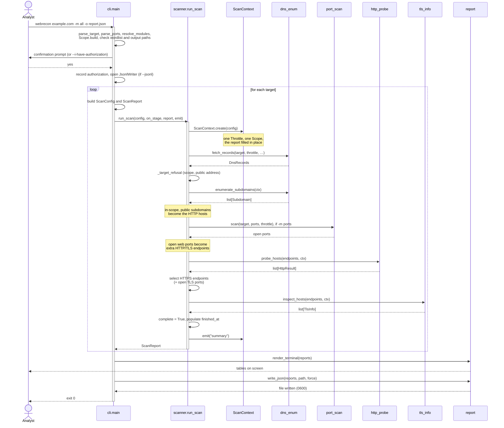
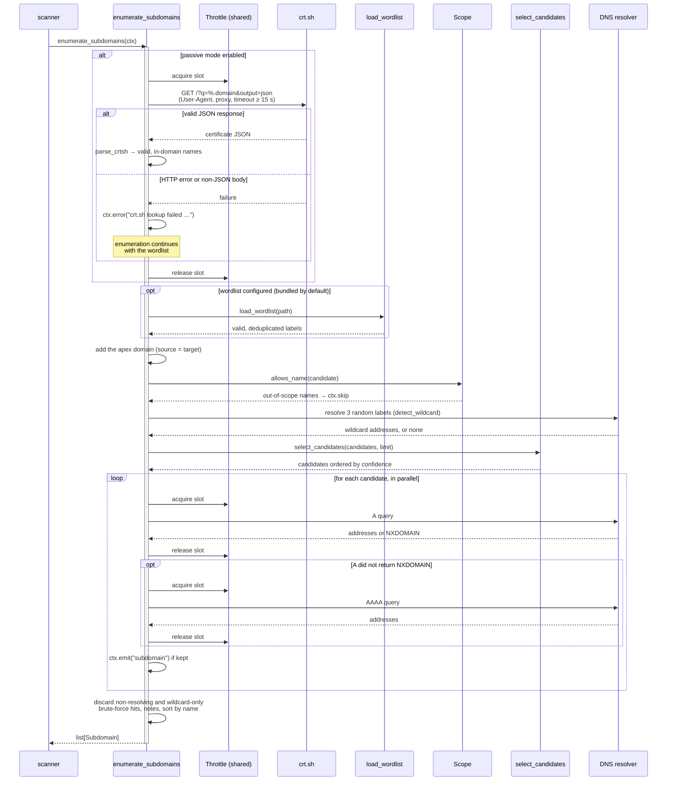
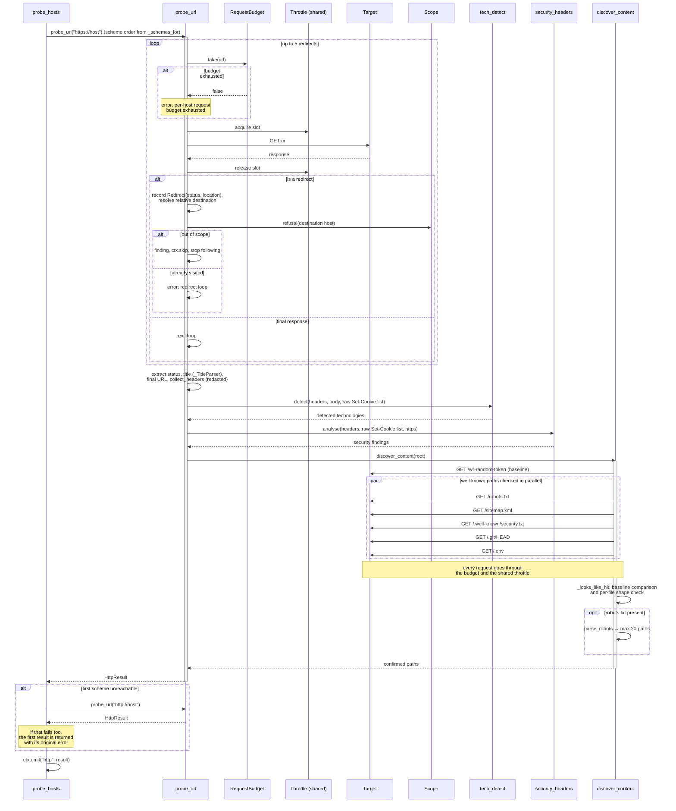
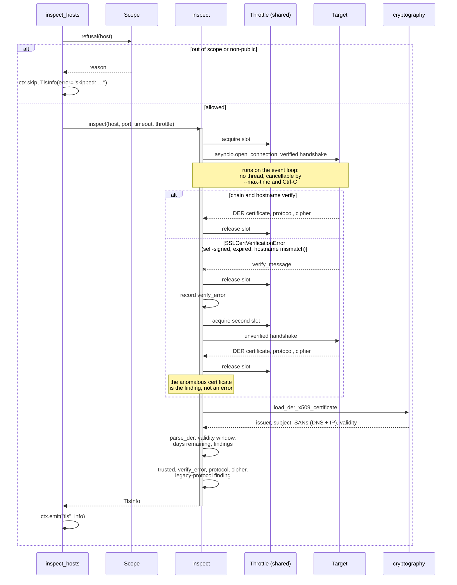
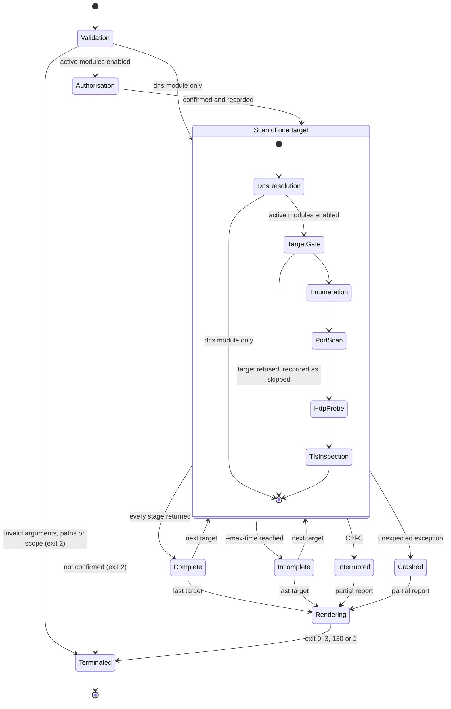
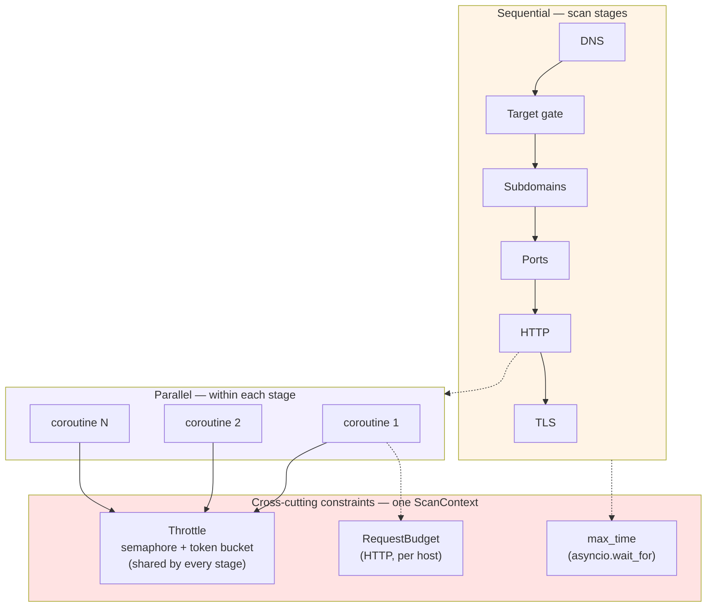
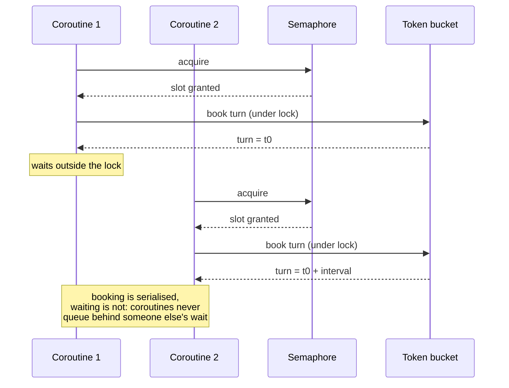
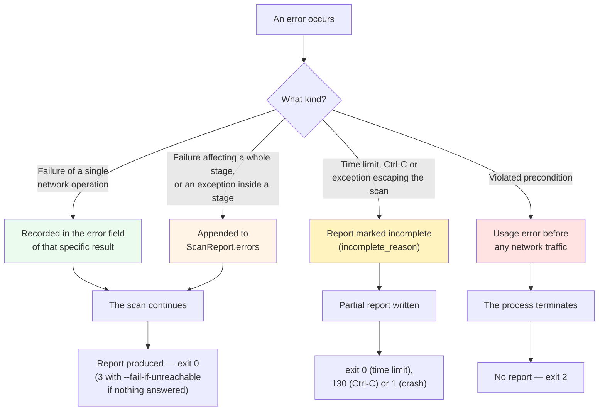
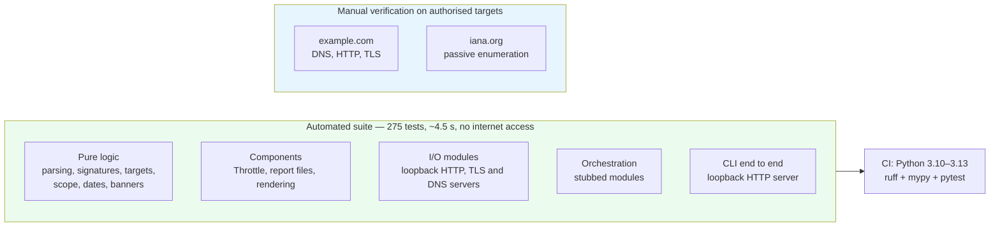

# 4. Runtime behaviour

| | |
| --- | --- |
| Document | SDD-04 — Dynamic view |
| System | webrecon 0.2.0 |
| Status | Approved |
| Last revised | 2026-11-16 |

## 4.1 Purpose

This document describes what happens at runtime: the sequence of interactions
between components, the scan lifecycle, error propagation, and the concurrency
model. The corresponding static structure is in
[01-architecture.md](01-architecture.md).

## 4.2 Overall scan sequence

Two points are worth noting. First, how hosts pass between stages: discovered
subdomains feed the HTTP probe, open web ports found by the port scan add
endpoints, and only endpoints answering over HTTPS (plus open TLS ports) feed
the TLS inspection. Each stage narrows or targets the set the next one works on,
which contains traffic towards the target. Second, every stage receives the
same `ScanContext`, so the throttle, the scope and the report are shared; each
result is also handed to `emit` as soon as it exists, which is how `--jsonl`
writes incrementally.

When only the `dns` module is enabled, the CLI asks for no confirmation and the
scan ends after `fetch_records`: neither the target gate nor any active stage
runs.

## 4.3 Subdomain enumeration

## 4.4 HTTP probe with redirect chain

## 4.5 TLS inspection

In 0.1.0 the handshake ran in a worker thread through `asyncio.to_thread`. A
thread cannot be cancelled, so a slow handshake outlived both the timeout and
Ctrl-C; and the unverified retry returned an empty dictionary. Running the
handshake with `asyncio.open_connection` and reading the DER form solves both.

## 4.6 Scan lifecycle

Every stage is entered even when its module is disabled: in that case it
produces no results and hands control straight to the next one. An exception
inside a stage does not leave the `Scan` state: `_guarded` records it and the
next stage starts. `Crashed` covers only an exception that escapes `run_scan`
altogether.

Unlike 0.1.0, the `Interrupted` and `Crashed` states write the requested report
files: the reports are filled in place, so `cli.main` marks the unfinished ones
with `incomplete_reason` and renders them. Remaining targets are not scanned.
`Incomplete` (time limit) instead moves on to the next target.

## 4.7 Concurrency model

The system uses a single event loop per target in a single process
(`asyncio.run` is called once per target). Parallelism is cooperative and lives
entirely within individual stages, never across them. The only thread is the
optional AXFR transfer.

**Why stages stay sequential.** Each stage depends on the previous one's output:
without subdomains there is no way to know which hosts to probe, without the
port scan no way to know which non-standard web ports to probe, and without the
HTTP responses no way to know whose certificate to inspect. Parallelising them
would mean probing hosts not yet discovered.

**Why in-stage parallelism is bounded.** Every coroutine passes through the
**same** `Throttle` before each outbound call — DNS queries, the crt.sh request,
HTTP requests, TLS handshakes, the address lookups and port connections. The
semaphore limits how many operations are in flight, the token bucket how many
start per second. With `-c 5 -r 10` the system never exceeds five simultaneous
operations nor ten per second, across all modules together, however many hosts
are queued. In 0.1.0 each module had its own throttle, so the effective rate was
a multiple of `--rate`; the shared instance is verified by
`TestRunScan::test_every_module_shares_one_throttle` and, against loopback
servers, by the rate tests of each I/O module.

**Time limit.** With `--max-time`, `run_scan` wraps the whole stage sequence in
`asyncio.wait_for`. When the deadline expires, the running coroutines are
cancelled — including throttle waits and TLS handshakes, which are cancellable —
and the report keeps everything gathered up to that instant.

### Semaphore and token bucket interaction

The lock protects only the turn computation; the wait happens outside it. Were
the wait inside the lock, every coroutine would wait for the sum of all previous
waits and the effective rate would collapse.

## 4.8 Error propagation

The system distinguishes four levels of failure, with different destinations.

| Level | Examples | Destination | Effect |
| --- | --- | --- | --- |
| Operation | Unreachable host, HTTP timeout, redirect loop, budget exhausted, TLS port closed, unverifiable certificate, one DNS query failing | `HttpResult.error`, `TlsInfo.error`, `TlsInfo.verify_error`, `DnsRecords.status` | That single result carries the error; other hosts are unaffected. |
| Stage | No DNS records resolved, crt.sh unreachable, port scan target unresolvable, unexpected exception in a stage, target out of scope | `ScanReport.errors`, `ScanReport.skipped`, `ScanReport.notes` | The stage produces no (or partial) data; later stages proceed on what is available. |
| Scan | `--max-time` reached, Ctrl-C, exception escaping `run_scan`; or, at the end of a scan, any entry in `errors` or an in-scope host whose HTTP or TLS attempts all timed out | `complete=False`, `incomplete_reason`, `errors` | The report keeps everything gathered and is written; exit 0, 130 or 1 respectively. |
| Process | Unknown module, invalid target or scope entry, missing wordlist, malformed ports or numbers, unusable output path, authorisation not confirmed | `argparse` usage error | The process terminates before the scan, writing no report; exit 2. |

The fourth level's preconditions are checked **before** any network traffic
starts: a typo must not cost the user a full scan with an unexpected result.
Every error at the first three levels is visible in all report formats: the
terminal and HTML outputs list errors, unreachable hosts, skipped hosts and
notes, not only successful results.

## 4.9 Indicative timing profile

Measurements taken with version 0.1.0 against `example.com` and `iana.org` from
a home connection, as an order of magnitude.

| Configuration | Hosts resolved | Duration |
| --- | --- | --- |
| `-m dns,http,tls --no-passive` | 1 | ~1 s |
| `-m subdomains` with a 138-entry wordlist and crt.sh | 15 | ~13 s |
| `-m ports` over 3 ports | 1 | ~1 s |

The dominant factor is the number of candidates to resolve, not the number of
enabled modules. Since 0.2.0 the default profile uses the bundled 138-entry
wordlist, each candidate costs up to two throttle slots (A and AAAA), and
enumeration adds three wildcard probes, so `--no-wordlist` is the fastest
option when brute-force is not needed. The crt.sh lookup is allowed at least
15 seconds whatever `-t` says. With `--rate` set, the duration has a lower bound
by construction of the token bucket: `n` operations at `r` per second cannot
complete in less than `n / r` seconds — and since the throttle is now shared,
`n` counts the operations of every module. `--max-time` gives an upper bound.

## 4.10 Verification strategy

The automated suite sends no traffic beyond the loopback interface. The fixtures
in `tests/conftest.py` start, on ephemeral `127.0.0.1` ports, a threaded HTTP
server with programmable routes (optionally wrapped in TLS), certificates
generated on the fly with `cryptography` (self-signed, expired, not yet valid,
wrong hostname), and a UDP DNS server answering from a dictionary with optional
wildcard and SERVFAIL names. The I/O functions — `fetch_records`,
`enumerate_subdomains`, `probe_url`, `discover_content`, `probe_hosts`,
`inspect`, `check_port`, `scan` — are therefore exercised against real sockets,
including their rate limiting, rather than being stubbed as in 0.1.0. Only
`tests/test_scanner.py` replaces the modules with stubs, to verify orchestration
(stage order, endpoint propagation, shared throttle, target gate, time limit,
stage isolation) independently of the network. This keeps the tests
deterministic, runnable offline and free of traffic towards third-party
systems — a non-negotiable requirement for the CI of a security tool.
